# BPH & TAE Ecosystem Map

> **Version:** 1.5 | **Last Updated:** 2026-10-30 | **Maintainer:** CrimsonVector Research
>
> This document maps the bullet-proof hosting (BPH) and Threat Activity Enabler (TAE) ecosystem, charting the supply chain from bare metal to criminal end-user, the geographic clusters where these operations concentrate, the corporate relationship networks that sustain them, and the financial infrastructure that monetizes them. Risk tier references follow the classification system defined in [`taxonomy/BPH_TAXONOMY.md`](../taxonomy/BPH_TAXONOMY.md). The Appendix A/B reference tables are generated from `BPH_Master.csv` and are authoritative; the narrative sections 1–6 are hand-maintained and may lag the CSV.

---

> **2026-10-30 routing audit:** Every CSV ASN and listed prefix was re-checked against RIPEstat and Spamhaus. Altawk's AS209946 and both MIRhosting ASNs went dark in October; WorkTitans withdrew nearly all of its space and now transits ADCDATA.COM and FBW Networks; GCSAS was added to and Cloudzy restored to Spamhaus ASN-DROP; Spamhaus attributed new ASNs to Pfcloud (AS205329) and Chang Way (AS218974). Sections 3.1, 3.2 and 4 and both appendices reflect this. A follow-up pass the same day raised GCSAS to T1 (it and its Sevastopol sister GIR are Recorded Future's #7 '4VPS'), added GIR/4VPS (T1), BL Networks/BitLaunch (T3) and four watch-list rows (Andwase, Prostie Reshenia, Zomro, Evoxt), and resolved most remaining 'unverified' caveats. The same audit's research pass changed four rows' status or tier (WorkTitans -> seized, QWINS -> dissolved, Cloudzy T3 -> T2) and added TokenSpot CJSC and Xeltox Enterprises (Cryptomus/Heleket) to §5.1 and Appendix A.

> **2026-10-29 update (Operation Omegaline):** Virtualine/Omegatech was seized on 2026-10-27. §3.2 and §3.7, the peering table and Appendices A and B now show Railnet/Virtualine as `seized` and AS202412 as disrupted rather than live. AS219199 (GENYUS SOFT LTD) is recorded in §3.7 as an unconfirmed lead, not an attribution. AnonRDP / Blatant Technologies (AS403005, with the deregistered GHOSTYNETWORKS AS205759) was added as a T1 row; its anonrdp[.]com domain went to FBI seizure nameservers the same day. On 2026-10-30 the metaspinner-named AS209800 front was raised from T3 to T2.

> **2026-09-25 audit:**
> - **Appendices.** Appendices A and B were regenerated from `BPH_Master.csv` (70 rows), with every ASN re-checked against registry and Spamhaus ASN-DROP data.
> - **Follow-up decisions.** A new `dormant` status now marks ELITETEAM, HOSTYPE and SWISSNETWORK02/Global-Data. CDNCloud was removed as unsourced. Kaopu Cloud HK, PrivateAlps/Private Layer and MIRhosting were raised to T1 (see the taxonomy and each CSV row for the basis).
> - **Narrative corrections.** Sections 1-6 were corrected where the audit found errors:
>   - the Aeza hierarchy (§3.3);
>   - the Zservers ASN history (§3.5);
>   - the FUNNULL/CTG relationship (§3.4);
>   - the aurologic downstream set (§3.2);
>   - the UK-shell legal facts (§2.2);
>   - the Garantex successor table (§5.1).
> - **New sections.** §3.6 covers Cl0p's repeated use of HostZealot; §3.7 covers the Virtualine identity chain.
> - **Not yet diagrammed.** These clusters are tracked in the CSV but have no diagram:
>   - SEA guarantee marketplaces (Huione -> Tudou -> H-Pay / Xinbi; Dabai);
>   - BtHoster and its transit (UAB Host Baltic, Tube-Hosting);
>   - Pfcloud;
>   - the proxy-enabler lineage (911 S5 -> Moonlander -> SocksEscort -> IPIDEA -> Asocks -> NetNut -> QTFY/QTRouter);
>   - the Iranian exchange designations.
>
> **Reading ASNs in this document.** An ASN marked *historical/reassigned* now belongs to an unrelated organisation and must not be blocked as the entity named here.

## Table of Contents

1. [The BPH Supply Chain](#1-the-bph-supply-chain)
2. [Geographic Clusters](#2-geographic-clusters)
3. [Corporate Relationship Networks](#3-corporate-relationship-networks)
4. [Upstream/Downstream Dependencies](#4-upstreamdownstream-dependencies)
5. [Financial Infrastructure Overlay](#5-financial-infrastructure-overlay)
6. [Cross-Reference with IOCTA 2026 Themes](#6-cross-reference-with-iocta-2026-themes)
- Appendices: [A - Entity quick reference](#appendix-a-entity-quick-reference) · [B - ASN cross-reference](#appendix-b-asn-cross-reference-index) · [C - Relationship graph](#appendix-c-relationship-graph) (all generated from the data)

---

## 1. The BPH Supply Chain

BPH infrastructure does not exist in isolation. It depends on the same physical, logical, and financial layers as legitimate hosting but deliberately introduces opacity at each tier. The supply chain runs from physical datacenter through multiple abstraction layers to the criminal end-user, with each layer creating jurisdictional and evidentiary gaps that frustrate law enforcement.

```
+=====================================================================+
|                        BPH SUPPLY CHAIN                             |
+=====================================================================+
|                                                                     |
|  PHYSICAL LAYER (Bare Metal)                                        |
|  +---------------------------------------------------------------+  |
|  | Datacenters / Colocation Facilities                           |  |
|  | - Tornado Datacenter (Langen, DE) - aurologic primary site    |  |
|  | - Chisinau (Moldova) - AlexHost                               |  |
|  | - St. Petersburg facilities - Aeza, PINSPB, Media Land        |  |
|  | - Serverion (NL) - reported colo of seized CrazyRDP host      |  |
|  | - Proprietary deployments by criminal orgs (IOCTA 2026 trend) |  |
|  +---------------------------------------------------------------+  |
|                            |                                        |
|                            v                                        |
|  NETWORK LAYER (Routing & Addressing)                               |
|  +---------------------------------------------------------------+  |
|  | ASN Registration & IP Allocation                               |  |
|  | - RIPE NCC as primary RIR (European/CIS allocations)          |  |
|  | - LIR status grants direct control over IP resources           |  |
|  |   (aurologic, Stark pre-sanctions, others)                    |  |
|  | - ASN registration via RIPE: low barrier, shell-company ready  |  |
|  | - BGP announcement of allocated/transferred prefixes           |  |
|  | - Transit/peering agreements with upstream providers           |  |
|  |   (Tier 1 carriers often unaware of downstream abuse)         |  |
|  +---------------------------------------------------------------+  |
|                            |                                        |
|                            v                                        |
|  SERVICE LAYER (Provisioning & Management)                          |
|  +---------------------------------------------------------------+  |
|  | VPS/RDP Provisioning & Management Platforms                    |  |
|  | - VMmanager / ISPsystem (Russian-origin server mgmt panels)   |  |
|  | - WHMCS (billing & client management automation)               |  |
|  | - Custom panels (some BPH operators build proprietary tools)   |  |
|  | - Automated provisioning: credit card or crypto -> instant VPS |  |
|  | - RDP-as-a-service: pre-configured Windows instances           |  |
|  |   (CrazyRDP model before seizure)                             |  |
|  | - Shared fingerprints across operators using same platforms     |  |
|  |   (WIN-J9D866ESIJ2 hostname reuse across Stark successors)    |  |
|  +---------------------------------------------------------------+  |
|                            |                                        |
|                            v                                        |
|  CUSTOMER LAYER (Criminal End-Users)                                |
|  +---------------------------------------------------------------+  |
|  | Ransomware Affiliates                                          |  |
|  | - LockBit, BianLian, Hunters International (Zservers clients) |  |
|  | - 120+ active ransomware brands in 2025                       |  |
|  | Botnet Operators                                                |  |
|  | - C2 servers, loader distribution, exfiltration staging        |  |
|  | APT Groups                                                      |  |
|  | - Nation-state actors using BPH as cutout infrastructure       |  |
|  | - Hybrid threat actors (criminal infrastructure for state ops) |  |
|  | Infostealer Operators                                           |  |
|  | - Rhadamanthys, Lumma, RedLine distribution & C2               |  |
|  | DDoS-for-Hire / Hacktivism                                      |  |
|  | - NoName057(16) operations                                     |  |
|  | Phishing / Pig-Butchering Syndicates                            |  |
|  | - FUNNULL-hosted scam panels ($200M+ losses)                   |  |
|  +---------------------------------------------------------------+  |
|                            |                                        |
|                            v                                        |
|  FINANCIAL LAYER (Monetization & Payment)                           |
|  +---------------------------------------------------------------+  |
|  | Cryptocurrency Payment Rails                                    |  |
|  | - Bitcoin/USDT/TRON for hosting payments                       |  |
|  | - Garantex (seized 2025) -> Grinex; A7A5 stablecoin rails     |  |
|  | - Cryptomixer.io (seized Nov 2025, EUR 1.3B mixed since 2016) |  |
|  | - Privacy coins (Monero) for premium anonymity                 |  |
|  | - Chain-hopping via blockchain bridges                          |  |
|  | - Crypto-to-cash desks for final offramp                       |  |
|  | - Designated wallets: TRON TU4tDFRvcKhAZ1jdihojmBWZqvJhQCnJ4F |  |
|  |   (on the Aeza Group LLC SDN entry)                           |  |
|  +---------------------------------------------------------------+  |
|                                                                     |
+=====================================================================+
```

### Key Supply Chain Observations

1. **Jurisdictional Layering by Design.** Each supply chain layer typically sits in a different jurisdiction. A physical server in Germany (aurologic/Tornado DC) may be leased to a UK shell company (Femo IT), which sells VPS to an anonymous customer paying via a Seychelles-registered crypto exchange. No single law enforcement agency has visibility across the full chain.

2. **LIR Status as Force Multiplier.** Entities operating as RIPE Local Internet Registries gain direct control over IP address allocation, enabling rapid prefix transfers between related entities without third-party gatekeeping. This is the mechanism behind prefix-hopping evasion (see Taxonomy, Pattern 3.4).

3. **Provisioning Platform Fingerprints.** Shared use of VMmanager/ISPsystem creates detectable fingerprints across ostensibly unrelated BPH operations. The WIN-J9D866ESIJ2 RDP hostname, observed by GreyNoise/Censys migrating from Stark Industries prefixes to THE.Hosting/WorkTitans prefixes, demonstrates that the service layer often survives corporate restructuring unchanged.

4. **Proprietary Infrastructure as Emerging Threat.** IOCTA 2026 documents a trend toward criminal organizations deploying their own hardware in colocation facilities, bypassing the hosting provider layer entirely and eliminating a critical evidence source.

---

## 2. Geographic Clusters

BPH operations concentrate in specific geographic corridors, each offering distinct advantages to operators.

### 2.1 Russia / St. Petersburg Nexus

**Role:** Epicenter of Russian-language BPH operations. St. Petersburg hosts the highest concentration of sanctioned and T1-classified hosting providers globally.

| Provider | ASN(s) | Risk Tier | Status | Key Detail |
|----------|--------|-----------|--------|------------|
| **Aeza Group / Aeza International (UK front)** | AS210644, AS216246, AS203273 | T1 | Sanctioned (OFAC July 2025; UK Nov 2025) | Owners Penzev and Bozoyan detained by Russian authorities April 2025 (BlackSprut case); TRON address on the Aeza Group LLC SDN entry; still hosting Dark Caracal C2 in 2026 |
| **Media Land LLC** | AS206728, AS215376 (ML Cloud) | T1 | Sanctioned (US/UK/AU Nov 2025; EU July 2026) | Yalishanda (Volosovik); DOJ indictment July 2026 ($62M+ losses) |
| **PINSPB** | AS44050, AS34665 | T2 | Flagged | Long-running St. Petersburg hoster; Cl0p torrent seeder on AS34665 (Unit 42, 2023) |
| **PROSPERO / Proton66** | AS200593, AS198953 | T1 | Flagged | Forum-advertised BPH (Intrinsec); both ASNs on Spamhaus ASN-DROP; 2026 tenants include ShinyHunters and a The Gentlemen affiliate |
| **ELITETEAM / 1337TEAM** | AS51381, AS56873 | T1 | Dormant (network dark) | Seychelles registration; announces no prefixes as of Sept 2026 but still on ASN-DROP |
| **UFO Hosting LLC** | AS33993 | T2 | Evading | Russian prefix migration vehicle for Stark Industries; Spamhaus lists it under stark-industries.solutions |

**Why St. Petersburg:** Proximity to technical talent pools, established underground forum communities (XSS, Exploit), permissive jurisdictional environment for hosting, limited Western LE cooperation, and an ecosystem of crypto payment processors. The city functions as a self-reinforcing cluster where providers share datacenter facilities, transit, and even customers.

### 2.2 UK Shell Company Pattern

**Role:** Preferred jurisdiction for corporate shells. Registration at Companies House is fast and cheap, and UK-registered entities look legitimate to RIPE and to customers. The pre-2024 picture of "no filings, no ID checks, GBP 12" is out of date (see below).

| Provider | ASN | UK Entity | Status | Key Pattern |
|----------|-----|-----------|--------|-------------|
| **Stark Industries** | AS44477 (historical) | Ltd 13906017, dissolved 2025-09-16 | Dissolved (EU-listed) | Original template for UK-shell BPH |
| **GCSAS** | AS215540 | LLP OC450701 (dormant accounts) | Flagged (T1) | 181 prefixes; Gamaredon (2023) and SpiceRAT (2026) C2 hosting; on Spamhaus ASN-DROP since Oct 2026 |
| **QWINS** | AS213702 (+AS218731, AS214422) | Ltd 16072422, dissolved 2026-07-14 | Dissolved (T2; network live) | Short corporate history; three ASNs on Spamhaus ASN-DROP |
| **Femo IT / Defhost** | AS214351 | Ltd 15885164, strike-off notice 2026-10-13 | Flagged (T1) | aurologic downstream; self-advertised abuse-resilient hosting |
| **Hypercore** | AS211522 (dark) | Ltd 16558658, dissolved 2025-12-23 | Sanctioned (OFAC Nov 2025) | Aeza front, designated ~4.5 months after Aeza |
| **XHOST Internet Solutions** | AS197414 (historical) | LP | Sanctioned (UK, Feb 2025) | Zservers UK front |
| **Aeza International** | (Aeza Group ASNs) | Ltd 15109642, dissolved 2026-03-24 | Sanctioned (OFAC July 2025) | UK front of Russian Aeza Group LLC |
| **Silent Connection** | AS215240 (re-registered, dark) | Ltd 15578799, dissolved 2025-01-28 | Dissolved | Network dark since the ASN was re-registered to a German UG |
| **Dolphon 1337** | AS215208 (recycled) | Dolphin 1337 Limited 15589896, dissolved 2025-01-14 | Dissolved | ASN now held by an Indonesian ISP |

**The UK shell pattern (updated 2026-09):**

```
Step 1: Incorporate a UK Ltd or LLP (online fee GBP 100 from 2026-02-01;
        GBP 50 from May 2024; GBP 12 before that)
        -> Mass registered-office address (e.g. 71-75 Shelton Street, London);
           must be an "appropriate address" since 2024-03-04 (no PO boxes)
        -> Directors, LLP members and PSCs must verify identity (mandatory
           from 2025-11-18; nominees included)

Step 2: Become a RIPE NCC member (LIR) or obtain resources via a sponsoring LIR
        -> RIPE NCC checks registry documents (with third-party data such as
           Dun & Bradstreet) and screens against sanctions - it confirms legal
           existence, not intent
        -> Ltds and LLPs must still file annual accounts; overdue or dormant
           filings are an investigative lead, not a loophole

Step 3: Obtain an ASN (2-5 business days, per CISA) and IPv4 space
        -> IPv4 is exhausted: new LIRs join a waiting list for one /24, so most
           space is transferred or leased
        -> Announce via a permissive upstream (historically aurologic AS30823)

Step 4: Operate; when flagged or dissolved, move on
        -> RIPE transfer policy bars re-transferring IPv4 and 16-bit ASNs for
           24 months, and RIPE NCC freezes EU-sanctioned holders' resources, so
           operators often abandon the ASN (which is later re-issued) and move
           the prefixes to a fresh shell
```

**Why the UK (2026 view):** Online formation still takes about a day and costs little, nominee arrangements remain common, and a UK registration still lends legitimacy. But since the Economic Crime and Corporate Transparency Act reforms, every director and PSC is identity-verified, confirmation statements carry a lawful-purpose statement and a registered email address, and accounts must be filed -- so UK shells now leave a richer paper trail than offshore ones. The "typical lifecycle: 6-18 months per entity" figure is unsourced.

### 2.3 Netherlands Infrastructure Hub

**Role:** Preferred jurisdiction for BPH operations requiring legitimate-looking infrastructure, dense peering, and high-bandwidth connectivity.

| Provider | ASN | Location | Risk Tier | Key Detail |
|----------|-----|----------|-----------|------------|
| **MIRhosting B.V.** | AS52000, AS206932 | Netherlands | T1 | Founded 2004 by Andrey Nesterenko (arrested in the May 2026 FIOD raid); WorkTitans' sole connectivity until both MIRhosting ASNs went dark (Sept-Oct 2026) |
| **WorkTitans / THE.Hosting** | AS209847, AS213999 | Netherlands | T1 (sanctions evasion) | Owner Youssef Zinad; sole shareholder Fezzy B.V.; Stark successor; FIOD raid May 2026 |
| **aurologic GmbH** | AS30823, AS43043 | Langen, DE | T2 (Upstream Enabler) | RF: transits ~70% of prominent high-risk TAE networks |

**Why the Netherlands:** The Amsterdam Internet Exchange (AMS-IX) and surrounding facilities provide some of the densest peering in Europe. Netherlands hosting culture has historically been permissive, with strong privacy protections. Dutch B.V. (besloten vennootschap) entities are relatively simple to establish. The proximity to DE-CIX (Frankfurt) and LINX (London) provides excellent connectivity. For BPH operators, the Netherlands offers the appearance of Western European legitimacy combined with high-performance infrastructure -- though Dutch police and the FIOD have now seized BPH servers at least three times (Zservers Feb 2025, the CrazyRDP-attributed hoster Nov 2025, WorkTitans May 2026), plus the Asocks-attributed proxy backend (May 2026).

### 2.4 Moldova Corridor

**Role:** Jurisdiction with limited law enforcement cooperation capacity, functioning as operational base for BPH providers requiring physical infrastructure outside EU/NATO reach.

| Provider | ASN | Location | Risk Tier | Key Detail |
|----------|-----|----------|-----------|------------|
| **AlexHost** | AS200019, AS207636 | Chisinau | T4 | DMCA-ignored offshore hosting; Dark Caracal Bandook C2 (2026); Cl0p Cleo callback (2024) |
| **PQ Hosting Plus S.R.L.** | AS44477 (historical) | Moldova | T1 (sanctions evasion; not itself listed) | Neculiti-linked; received AS44477 four days before the EU listing |

**Why Moldova:** Moldova sits outside the EU (though an EU candidate), has limited cybercrime enforcement capacity, and offers geographic proximity to both Russia and Romania. The Neculiti brothers' PQ Hosting operation shows how Moldovan entities serve as waypoints in sanctions-evasion chains: AS44477 moved from Stark Industries to PQ Hosting Plus S.R.L. four days before the EU listing. (The frequently repeated claim that AlexHost colocates in a Soviet-era bomb shelter is unverified.)

### 2.5 Asia-Pacific / Triad Nexus

**Role:** Infrastructure laundering, pig-butchering hosting, and CDN-based abuse at scale, often tied to organized crime networks (Triads) operating across Southeast Asia.

| Provider | ASN | Location | Risk Tier | Key Detail |
|----------|-----|----------|-----------|------------|
| **FUNNULL Technology** | (CDN, no ASN of its own) | Philippines (Taguig); Chinese administrator | T1 / Sanctioned | Liu Lizhi; >$200M US victim-reported losses; 548 CNAMEs -> 332,000+ domains (FBI) |
| **CTG Server Limited** | AS152194 | Hong Kong | T1 (not designated) | Hosted FUNNULL points of presence; on Spamhaus ASN-DROP; ~6% of DCloud scam domains on BPH like CTG (Infoblox) |
| **Kaopu Cloud HK** | AS138915, AS58854, AS154177 | Hong Kong | T1 | RF 2025 Threat Density #4; three ASNs on ASN-DROP; RedHotel C2, ToolShell exploitation, GobRAT staging |
| **Chang Way Technologies** | AS57523, AS59425, AS207566 (+2 shell ASNs) | Hong Kong | T2 | Proton66-linked rotating shell ASNs on ASN-DROP |
| **SHANGXING TECH LIMITED** | AS400619 (AROSSCLOUD origin ASN) | Hong Kong / US | T2 (first-party) | China-nexus C2 and mass-exploitation staging |
| **Shinjiru** | AS45839 | Malaysia | T4 | Long-running permissive hoster; "offshore" marketed |
| **StarCloud Global** | AS140224, AS149040 (both dark) | Singapore | T3 | Triad Nexus infrastructure (Silent Push, relayed); ESET Silver Fox hosting; *not* sanctioned |

**The FUNNULL infrastructure-laundering model:**

```
FUNNULL CDN (Funnull Technology Inc., OFAC May 2025)
      |
      +--> Points of presence on several hosting ASNs
      |    (CTG Server Limited AS152194 among them; ~40% of PoPs on
      |     Microsoft/Amazon IPs in Silent Push's 2024 mapping)
      |
      +--> 548 CNAMEs linked to 332,000+ domains (FBI, May 2025)
      |       |
      |       +--> Accounts at AWS, Cloudflare, Google, Microsoft
      |            (compromised, or opened via "clean" front companies
      |             such as Bole CDN / CDN1.ai launched before sanctions)
      |
      +--> US-IP geofencing
              |
              +--> Returns HTTP 451 to US investigator IPs
              +--> Serves scam content to APAC victim IPs
```

**Why APAC:** Proximity to Triad-operated scam compounds (Myanmar, Cambodia, Laos). Hong Kong's business registration ease. Malaysia's historically permissive hosting regulation. The ability to use accounts at global cloud providers (AWS, Cloudflare, Google, Microsoft) means FUNNULL's actual infrastructure footprint is diffuse and parasitic on legitimate platforms, making traditional ASN-based blocking ineffective.

---

## 3. Corporate Relationship Networks

The following diagrams map the specific corporate structures, succession chains, and dependency relationships observed in the BPH ecosystem.

### 3.1 The Stark Industries Sanctions Evasion Chain

Stark Industries Solutions Ltd represents the most thoroughly documented BPH sanctions evasion case, demonstrating how a sanctioned entity can achieve seamless operational continuity through pre-positioned successor entities.

**Timeline:**

| Date | Event |
|------|-------|
| 2022-02-10 | Stark Industries Solutions Ltd incorporated (UK, 13906017) |
| 2022-2024 | Rapid growth; becomes one of Europe's largest BPH operations (RF: white-label front for PQ.Hosting) |
| 2025-03-13 | UFO Hosting LLC RIPE org registered (Russian prefix vehicle); transfers from 2025-04-10 |
| 2025-05-08 | RFE/RL Moldova reports the coming sanctions (the "12 days" heads-up) |
| 2025-05-13 / 05-16 | PQ Hosting Plus S.R.L. RIPE org created; AS44477 transferred to it **four days** before designation |
| 2025-05-20 | EU listing (Impl. Reg. (EU) 2025/965, hybrid-threats regime): Stark + Iurie and Ivan Neculiti |
| 2025-05-28 / 05-29 | ORG-THE3-RIPE created; THE.Hosting rebrand and prefix transfers begin |
| 2025-06-24 | WorkTitans B.V. AS209847 created (Netherlands; AS213999 also WorkTitans) |
| Aug-Nov 2025 | GreyNoise observes the migration off AS44477; Censys matches RDP hostname WIN-J9D866ESIJ2 on WorkTitans prefixes |
| 2025-09-16 | Stark Industries Solutions Ltd dissolved |
| 2026-04 | AS44477 leaves the routing table (ELLIO); later deregistered |
| 2026-05-18 | FIOD raid: 800+ servers seized; WorkTitans owner and MIRhosting founder arrested |

**Corporate Network Diagram:**

```
   PQ.HOSTING (Neculiti) -- RF: Stark's parent; Stark was its white label
                      |
        STARK INDUSTRIES SOLUTIONS LTD
        (UK 13906017; EU-listed 2025-05-20; dissolved 2025-09-16)
                      |
     +----------------+----------------+------------------+
     |                |                |                  |
     v                v                v                  v
 AS44477          WorkTitans B.V.   UFO Hosting LLC   MIRhosting B.V.
 (transferred     / THE.Hosting     (Russia)          (Netherlands)
  2025-05-16,     (Netherlands)      AS33993           AS52000
  now gone)       AS209847/AS213999       |              |
     |            owner Youssef Zinad;    v              v
     v            shareholder Fezzy B.V. Russian prefix  Sole upstream of
 PQ Hosting           |              migration        WorkTitans; founder
 Plus S.R.L.          v              vehicle          Nesterenko arrested
 (Moldova; NOT    Confirmed by                        2026-05-18; dark
  itself listed)  GreyNoise/Censys:
                  RDP hostname WIN-J9D866ESIJ2 reuse

 Spamhaus ASN-DROP lists AS209847, AS213999 and AS33993 under
 stark-industries.solutions. RF ties the chain's RIPE maintainer to one
 identity (Dmitrii Miasnikov) - a better pivot than company names.
```

**Analytical Assessment:** The Stark evasion chain demonstrates pre-planning. AS44477 moved to PQ Hosting Plus four days before the listing and UFO Hosting was registered 68 days before it, indicating awareness that designation was imminent. The THE.Hosting rebrand (nine days after) and WorkTitans' AS209847 (35 days after) completed the move to a Netherlands-based vehicle with no formal link to the listed entity. The RDP hostname reuse (WIN-J9D866ESIJ2) is the forensic smoking gun: the same server images were migrated from Stark prefixes to WorkTitans prefixes without reimaging. The May 2026 FIOD raid is the first enforcement action against the successor itself; reports conflicted on how much of the network survived it. Routing data now answers part of that: between 1 and 14 October 2026 AS209847 withdrew almost all of its space, keeping two /24s, and MIRhosting's ASNs stopped announcing altogether. The withdrawn blocks had not reappeared elsewhere by 2026-10-30. Watch for them under a new origin.

---

### 3.2 The aurologic GmbH Downstream Cluster

aurologic GmbH (AS30823, plus AS43043) operates from the Tornado Datacenter in Langen, Germany (CEO Joseph Maximilian Hofmann, also CEO of Tornado Datacenter). RF describes a multi-terabit backbone formed in 2023 from combahton GmbH's fastpipe network, and says aurologic transits about **70%** of the most prominent high-risk TAE networks. It remains the single most important upstream in the European BPH ecosystem -- but by September 2026 much of its named downstream had gone dark or been re-issued.

```
                        aurologic GmbH
                     AS30823 / AS43043
                 Langen, Germany (Tornado DC)
                 CEO: Joseph Maximilian Hofmann
                           |
   Named by RF Insikt (Nov 2025)          Named by Qurium (Doppelganger)
        |                                          |
  +-----+------+-----------+---------+       +-----+------+--------+
  |            |           |         |       |            |        |
Femo IT    Railnet /   metaspinner  Global-  Tnsecurity  WAIcore  Altawk
Defhost    Virtualine  -named       Data     AS216309    AS213887 AS203727
AS214351   AS214943    AS209800     SWISS-   (reissued)  (live)   (reissued)
(T1, live) (T1,       (reissued)   NETWORK  -> dark     T2       -> AS209946
           seized Oct              AS34888/                      dark, T2
           2026; net =              AS42624
           AS202412)                (dark)
        |
      Aeza (~50% of prefixes via aurologic, Nov 2025)
```

**Status of the named downstream (2026-09-25):**

| Downstream | ASN | Tier | State today |
|-----------|-----|------|-------------|
| Femo IT / Defhost | AS214351 | T1 | Live; 4 /24s on Spamhaus DROP |
| Railnet / Virtualine | AS214943 -> AS202412 | T1 | Seized 2026-10-27 (Operation Omegaline); AS214943 dark, AS202412 seen by 1 of 323 RIS peers |
| Tnsecurity / EVILEMPIRE | AS216309 | T2 | ASN re-issued to an Italian company -- defunct |
| metaspinner-named front | AS209800 | T2 | ASN re-issued -- defunct; ranges moved to AS202412, which was seized in Oct 2026 |
| WAIcore | AS213887 | T2 | Live (29 IPv4 prefixes) |
| Karina Rashkovska | AS215789 | T2 | ASN re-issued to BLIK -- defunct (Virtualine sub-network) |
| Altawk | AS209946 | T2 | Dark since 2026-10-02; still on ASN-DROP (earlier AS203727 re-issued) |
| SWISSNETWORK02 / Global-Data | AS34888 / AS42624 | T2 | Registered, no routes (dormant) |
| Aeza | AS210644 | T1 | Live, multi-homed |

KPROHOST, previously listed here, peered with Pfcloud rather than aurologic and is a Virtualine network. Karina Rashkovska's aurologic link rests on bgp.tools only.

**The Hofmann Denial:** aurologic's CEO has publicly denied a contractual relationship with Aeza, yet routing data showed Aeza prefixes transiting aurologic. Whether the relationship is direct or mediated through an intermediary (taxonomy Pattern 3.3, Sub-Sub-Leasing), the routing dependency is observable.

**Leverage:** depeering aurologic would now hit fewer live networks than in 2025 -- several downstreams have already collapsed or moved, and Virtualine's OMEGATECH network was seized in October 2026. Monitor where the survivors move rather than assuming the cluster is static.

---

### 3.3 The Aeza Group Front Company Structure

**Aeza Group LLC** (Russia) is the parent and the primary OFAC designee (2025-07-01). Aeza International Ltd is its UK front, and its evasion vehicles were designated on 2025-11-19.

```
                    AEZA GROUP LLC (Russia, St. Petersburg)
            OFAC 2025-07-01 (primary designee); UK 2025-11-19 (Russia regime)
            AS210644 / AS216246 (+ AS203273 NetCrafters OU, Spamhaus: aeza.net)
            TRON (SDN entry): TU4tDFRvcKhAZ1jdihojmBWZqvJhQCnJ4F
                                   |
      +-------------+--------------+--------------+----------------+
      |             |              |              |                |
      v             v              v              v                v
 Aeza           Aeza Logistic  Cloud Solutions  Hypercore Ltd    Datavice MCHJ
 International  LLC (RU,       LLC (RU,         (UK 16558658;    (Uzbekistan;
 Ltd (UK front, subsidiary)    subsidiary)      AS211522, dark;  est. 2025-07-03)
 15109642)      OFAC 07-2025   OFAC 07-2025     OFAC 11-2025)    OFAC 11-2025
 OFAC 07-2025                                                    + Smart Digital
                                                                  Ideas DOO (Serbia)
                                                                  OFAC 11-2025

   PERSONNEL (OFAC):
   +------------------------------------------------------------------+
   | CEO + 33%: Arsenii Penzev  | GD + 33%: Yurii Bozoyan              |
   | Technical director: Gast   | 33% owner: Igor Knyazev              |
   | 2025-11: Maksim Makarov (new executive); Ilya Zakirov (new       |
   | companies and payment channels)                                  |
   | Penzev, Bozoyan and two staff detained by Russian authorities    |
   | in early April 2025 (BlackSprut drug-market case)                |
   +------------------------------------------------------------------+
```

**Analytical Assessment:** Aeza's fronts followed the designation within days: Datavice was established two days later, Hypercore's AS211522 was allocated about nine days later, and 2,100+ IPs began moving to it on 2025-07-20. Hypercore then operated undesignated for about four and a half months until the 2025-11-19 follow-on action, which also named the Serbian and Uzbek vehicles and two new operators. The April 2025 detentions were a Russian domestic prosecution over the BlackSprut market, not part of the Western sanctions track. Sanctions have not ended operational use: in 2026 Aeza networks hosted 23 of 24 Dark Caracal GoCaracal C2s (Arctic Wolf) and a macOS crypto-drainer's staging and C2 (Huntress), and Spamhaus added a third Aeza-attributed ASN (AS203273). **Corrections (2026-09-25):** Aeza International is UK-registered, not Russian, and is not the parent; Hypercore is not a subsidiary of Cloud Solutions; Datavice is a separate Uzbek company, not an "operational brand"; Hypercore's ASN is AS211522 (the earlier AS215552 belongs to an unrelated Romanian holder), and its designation was OFAC-only.

---

### 3.4 The FUNNULL / Triad Nexus CDN Laundering Network

FUNNULL represents a distinct model from traditional BPH: rather than operating dedicated infrastructure, it spreads points of presence across other providers' networks -- including accounts at major clouds -- to create a distributed, resilient and hard-to-attribute hosting layer.

```
    FUNNULL TECHNOLOGY INC. (Taguig, Philippines)
    OFAC 2025-05-29, with administrator Liu Lizhi
              |
              +--> Points of presence on several hosting ASNs
              |    (e.g. CTG Server Limited AS152194 -- a host, not a
              |     parent; CTG was not designated)
              |
              +--> 548 CNAMEs linked to 332,000+ domains (FBI FLASH)
              |         |
              |    +----+----+----+----+
              |    |    |    |    |    |
              |    v    v    v    v    v
              |   AWS  CF  GCP  MSFT  Other
              |   (compromised accounts, or accounts opened through
              |    "clean" fronts: Bole CDN, CDN1.ai, launched pre-sanction)
              |
              +--> US-IP geofencing layer
              |    Returns HTTP 451 to US IPs
              |    Serves scam content to APAC victims
              |
              +--> >$200M in US victim-reported losses
```

**Why This Model Is Dangerous:** Traditional BPH can be disrupted by depeering an ASN or blocking a CIDR range. FUNNULL's model distributes malicious infrastructure across the IP space of the world's most trusted cloud providers, making IP-based blocking impractical without massive collateral damage. The geofencing layer adds an evasion mechanism: investigators in the US see a 451 compliance page, while victims in APAC see the scam content. StarCloud Global, previously drawn here as a FUNNULL front brand, appears only in a relayed Silent Push table as Triad Nexus infrastructure and was **not** designated.

---

### 3.5 The Zservers Post-Sanctions Prefix-Hopping

Zservers (Barnaul) and its UK front XHOST Internet Solutions LP were designated on 2025-02-11 by the US (Zservers and two administrators), the UK (Zservers, the LP and six individuals) and Australia (Zservers and five individuals). UK and Australian texts tie Zservers infrastructure to the 2022 Medibank leak; Chainalysis later traced payments from LockBit, BianLian and Hunters International.

```
    ZSERVERS / XHOST (AS197414, historical; zservers.ru on ASN-DROP
    until at least Dec 2025; now deregistered)
    + XHOST INTERNET SOLUTIONS LP (UK front, UK-designated)
    [2025-02-11: US / UK / AU, lists differ by authority]
    [2025-02-12: 127 servers taken offline by Dutch police]
              |
              | Intrinsec (high confidence): Zservers prefixes moved to
              |
              +---> AS213194 (NECHAEVDS; 193[.]37[.]69[.]0/24)
              +---> AS61336  (Island Servers LTD; 91[.]247[.]38[.]0/24)
              +---> AS213010 (allocated March 2025; 3 /24s)
              |     (the operating company shares two Seychelles LLP
              |      officers with Zservers)

    CLIENTS (Chainalysis payment tracing; UK/AU official texts):
    +------------------------------------------+
    | LockBit | BianLian | Hunters International|
    | 2022 Medibank breach data (UK/AU)         |
    +------------------------------------------+
```

**Prefix-Hopping Mechanics:** After the sanctions and the Dutch seizure, Zservers' prefixes reappeared under three small ASNs with different organisational wrappers, none named Zservers and none on ASN-DROP today; the original XHOST ASN (AS197414) was later deregistered. This exploits blocklist latency: by the time the community updates blocklists for one ASN, the infrastructure has moved. **Correction (2026-09-25):** earlier versions gave Zservers' historical ASN as AS216071 and said upstreams had depeered it. AS216071 is VDSina / SERVERS TECH FZCO (UAE), an active ~156,000-address network with no public link to Zservers; it has been removed from the database.

**Tracking Methodology:** Prefix-hopping can be tracked by monitoring: (a) BGP announcements for prefixes previously associated with sanctioned entities, (b) shared technical fingerprints (TLS certificates, server banners, scan behavior) across ASNs, (c) GreyNoise/Shodan temporal analysis showing infrastructure "teleporting" between networks, and (d) the Spamhaus ASN-DROP `domain` field, which ties new ASNs to known operators.

---

### 3.6 Actor-Preferred Providers: Cl0p and HostZealot

Not every recurring provider is a BPH. Cl0p's ten mass-exploitation campaigns (2020-2026) drew repeatedly on a small pool of commercial hosts. **HostZealot / HZ Hosting Ltd** (Bulgaria; AS59711, AS202015, AS61046, AS201525) appears in four of them: Accellion 2020, GoAnywhere 2023, MOVEit 2023 and Cleo 2024. Twenty-one HZ addresses appear in CISA, Mandiant, Lumen and Huntress lists, with block-level reuse over 18-27 months.

HZ runs KYC and is not on Spamhaus ASN-DROP, so it is tracked at T4 as an actor-preferred provider rather than a BPH. Data Campus, Datahome, ReliableSite, Krez 999 and Route 95 show the same pattern at smaller scale. See [`CL0P_HOSTZEALOT_REUSE.md`](CL0P_HOSTZEALOT_REUSE.md) and taxonomy §3.10.

---

### 3.7 The Virtualine Identity Chain

Virtualine Technologies is the clearest case of an operator outliving its number resources. It has used at least five identities, and on 2026-10-27 the FBI-led Operation Omegaline seized its domain and, with Dutch police, its servers in Limburg:

| Identity | ASN | State (2026-10-29) |
|----------|-----|-----------------|
| Railnet LLC (Kentucky) | AS214943 | Registered; dark since ~Feb 2026; delisted from ASN-DROP |
| KPROHOST LLC (Kentucky) | AS214940 | Dark since ~Aug 2026; listed under virtualine.org in Dec 2025 |
| Karina Rashkovska (likely) | AS215789 | Re-issued to BLIK |
| "metaspinner" front | AS209800 | Re-issued to ZEMA GbR; ranges moved to OMEGATECH |
| OMEGATECH / Omegatech LTD (Seychelles) | AS202412 | **Disrupted** 2026-10-27: seen by 1 of 323 RIS peers since; had 24 /24s in its last two weeks, all on Spamhaus DROP; ASN-DROP under virtualine.org |
| *Lead:* GENYUS SOFT LTD (Seychelles) | AS219199 | Not attributed. Announced four broker-leased /24s from 2026-10-22 (one previously on AS202412) and withdrew them the morning of the seizure; Spamhaus lists it under genyus.sc |

The reported upstreams were aurologic (~95%) and Pfcloud (one /24) as of August 2025; at the seizure AS202412's only neighbours were Pfcloud (AS51396) and PEERYX (AS213382), and a community traceroute still showed traffic reaching it through an aurologic DDoS-protection tunnel. RF ranked Virtualine #1 by Threat Density for 2025, and Intrinsec (May 2026) tied OMEGATECH to forum advertising and malspam infrastructure. DOJ's alias list (Secury, Massgod, Spamhouse, Lanedo, Omegatech) confirms two links this section had drawn from routing data: Omegatech, and the LANEDONET name on AS209800.

The chain is likely to grow. Virtualine sold shell-company migration as a service (its March 2026 "additional protection plan"), and after the seizure the operator wrote that it could rebrand in "a day, perhaps even less". Watch Spamhaus ASN-DROP for new ASNs under `virtualine.org`, new Seychelles or Kentucky shells taking the DROP-listed ranges in the CSV row, and new neighbours of Pfcloud. The Railnet/Virtualine row is T1 with status `seized`.

---

## 4. Upstream/Downstream Dependencies

### Critical Chokepoints

The BPH ecosystem contains several single points of failure where intervention would produce outsized disruption.

| Chokepoint | Type | Downstream Impact | Intervention Leverage |
|-----------|------|-------------------|----------------------|
| **aurologic GmbH (AS30823)** | Upstream Enabler | RF: ~70% of prominent high-risk TAE networks transit it; several named downstreams have since gone dark or moved (Section 3.2) | Upstream depeering or LIR action would still hit Femo IT/Defhost, WAIcore and part of Aeza |
| **UAB Host Baltic (AS209605) / Tube-Hosting (AS49581) / SS-Net (AS204428)** | Transit for AS-leasing BPH | BtHoster/BTCloud (AS213790, AS213388) | All three transit ASNs are themselves on Spamhaus ASN-DROP |
| **DDoS-Guard (AS57724, AS49612)** | DDoS Mitigation / Hosting | Historically ELITETEAM's upstream (as of Sept 2022, per Team Cymru); broader Russian ecosystem | Challenging -- DDoS-Guard also serves Russian government sites |
| **Voxility** | DDoS Mitigation | AlexHost DDoS protection (as previously reported; unverified in the 2026-09 audit) | Voxility has a legitimate customer base; targeted policy enforcement more appropriate than blanket action |
| **Serverion / Des Capital (AS213035 and 5 more ASNs)** | Colocation | Community sources place the seized CrazyRDP-attributed hoster in Serverion colocation (weak evidence) | Six serverion.com ASNs are on Spamhaus ASN-DROP (2026-09) |
| **RIPE NCC** | Resource Registry | All European BPH operations depend on RIPE for ASN/IP resources | Policy-level intervention: RIPE already runs KYC with third-party registry data, sanctions screening and a freeze on EU-sanctioned holders; the gap is intent, not legal existence |

### Dependency Matrix

```
                    UPSTREAM / TRANSIT
                    ==================
                    aurologic (AS30823)
                    UAB Host Baltic, Tube-Hosting, SS-Net (BtHoster transit)
                    Pfcloud (AS51396) (Virtualine transit)
                    MIRhosting (AS52000) (WorkTitans; dark since Oct 2026)
                    Tier 1 Transit (various)
                          |
          +---------------+---------------+
          |               |               |
    +-----------+   +-----------+   +-----------+
    | T1 BPH    |   | T2 BPH    |   | T3/T4     |
    | Providers |   | Providers |   | Providers |
    +-----------+   +-----------+   +-----------+
    | Aeza      |   | GCSAS     |   | HostSlick |
    | Media Land|   | QWINS     |   | NECHAEVDS |
    | PROSPERO  |   | WAIcore   |   | NETINNOV. |
    | Railnet/  |   | Altawk    |   | Tiger Net |
    |  Virtual. |   | KPROHOST  |   | HostZealot|
    | Femo IT   |   | Pfcloud   |   |  (T4)     |
    | ELITETEAM*|   | Chang Way |   |           |
    | Zservers  |   | CTG**     |   |           |
    | FUNNULL   |   |           |   |           |
    | WorkTitans|   |           |   |           |
    | Kaopu     |   |           |   |           |
    |PrivateAlps|   |           |   |           |
    +-----------+   +-----------+   +-----------+
          |               |               |
          +---------------+---------------+
                          |
                    END-USER CRIMINALS
                    ==================
                    Ransomware affiliates
                    Botnet operators
                    APT groups
                    Phishing operators
                    DDoS-for-hire

    * ELITETEAM is dormant: it announces no prefixes as of 2026-09.
    ** CTG Server Limited is T1 in the CSV; shown here beside the Asian cluster.
    MIRhosting (T1 since 2026-09-25) is shown in the upstream layer above.
```

### Peering Relationships of Note

| Provider A | Relationship | Provider B | Significance |
|-----------|-------------|-----------|--------------|
| DDoS-Guard (AS49612) | Historical transit (to 2022) | ELITETEAM (AS51381) | Team Cymru lists DDoS-Guard among ELITETEAM's upstreams as of Sept 2022; ELITETEAM was itself upstream of Filanco (AS3175) |
| aurologic (AS30823) | Transit | Aeza (AS210644) | ~50% of Aeza prefixes (Nov 2025); relationship disputed by aurologic's CEO |
| aurologic (AS30823) | Transit | Femo IT (AS214351) | Sole upstream (RF) |
| aurologic (AS30823) / Pfcloud (AS51396) | Transit | Railnet (AS214943) | ~95% / one /24 (Aug 2025) |
| Pfcloud (AS51396) / PEERYX (AS213382) | Neighbours | OMEGATECH (AS202412) | The only neighbours at the Oct 2026 seizure (RIPEstat) |
| SMARTNET Germany (AS203446) | Sole transit | AnonRDP / Blatant Technologies (AS403005) | Only neighbour of an ASN whose nine /24s are all on Spamhaus DROP (Oct 2026); a community post says the servers sit with UAB Host Baltic in Lithuania |
| MIRhosting (AS52000) | Sole connectivity (to Oct 2026) | WorkTitans (AS209847) | First peer in AS209847's aut-num; Krebs: "solely through MIRhosting". AS52000 has announced nothing since 2026-10-19 |
| ADCDATA.COM (AS135330) / FBW Networks (AS49434) | Transit | WorkTitans (AS209847) | Upstreams after MIRhosting went dark (Oct 2026); AS209847 is down to two /24s |
| UAB Host Baltic (AS209605), Tube-Hosting (AS49581) | Transit | BtHoster (AS213790) | Transit ASNs themselves on ASN-DROP |
| Fastmos (AS138644) | Shared /16 | AROSSCLOUD (AS400619) | The two tile 191[.]124[.]0[.]0/16 exactly -- reseller relationship |

---

## 5. Financial Infrastructure Overlay

The BPH ecosystem depends on a parallel financial infrastructure optimized for anonymity, sanctions evasion, and high-volume cryptocurrency processing.

### 5.1 The Garantex Succession

Garantex -- an exchange founded in 2019, OFAC-designated in April 2022 and taken down on 2025-03-06 -- was the central financial node for Russian-language cybercrime. Its takedown split three distinct categories that earlier versions of this map blurred: the **true successor** (Grinex), **Mendeleev-linked payment rails** (Exved, InDeFi Bank) and the **Shor/PSB A7 network** (A7, A71, A7 Agent, Old Vector and its A7A5 stablecoin).

```
                        GARANTEX (exchange, founded 2019)
          OFAC 2022-04-05 | EU 16th pkg 2025-02-24 | seized 2025-03-06
                                    |
         +--------------------------+---------------------------+
         |                          |                           |
   TRUE SUCCESSOR            PAYMENT RAILS                A7 NETWORK
   Grinex (Kyrgyzstan,       Exved; InDeFi Bank           A7 LLC; A71 LLC; A7 Agent LLC;
   registered Dec 2024)      (Mendeleev-linked)           Old Vector LLC -> A7A5 stablecoin
   OFAC 2025-08-14;          OFAC 2025-08-14              OFAC 2025-08-14; UK 2025-05/08;
   UK 2025-08-20;                                         EU 19th pkg (A7A5 ban 2025-11-25)
   drained & suspended
   2026-04-15/17
```

| Venue | Category | Status (2026-10) | Notes |
|-----------|--------|-------|-------|
| **Grinex** | True successor | Sanctioned (OFAC, UK, EU); suspended since April 2026 | Registered Dec 2024 |
| **TokenSpot CJSC** | Grinex front | Sanctioned (UK 2026-10-08) | Shared wallet infrastructure with Grinex (TRM, high confidence); $3.54B received Dec 2023 - Sept 2026 |
| **Exved** | Payment rail | Sanctioned (OFAC Aug 2025) | Separate designee, not an alias |
| **InDeFi Bank** | Payment rail | Sanctioned (OFAC Aug 2025) | Separate designee |
| **A7A5 (Old Vector; A7 LLC network)** | Ruble stablecoin | Sanctioned (OFAC, UK, EU; EU transaction ban from 2025-11-25); whole A7 Network an OFAC-designated TCO since 2026-10-01 | $93.3B moved "in less than a year" (Chainalysis); a stablecoin, not an exchange |
| **Rapira** | Russian-linked exchange | Sanctioned (UK 2026-05-26) | >$72M direct transactions with Grinex (Elliptic) |
| **Exmo** | Exchange | Sanctioned (UK 2026-05-26) | Pre-existing exchange |
| **ABCeX (Nueva Cryptologia)** | Exchange | Sanctioned (UK 2026-05-26) | |
| **Bitpapa** | P2P exchange | Sanctioned (OFAC 2024-03-25; UK 2026-05-26) | Designated before the Garantex takedown |
| **HTX (Huobi Global)** | Exchange | Sanctioned (UK 2026-05-26) | UK's first use of Reg. 17A against crypto exchanges |
| **Aifory Pro; MKAN Coin** | Unclear | Unverified | No source found for their successor role |
| **Cryptomus / Heleket (Xeltox Enterprises)** | Payment processor | Sanctioned (UK 2026-10-08) | Payment rail for Zservers, Stark, First VPN and Aeza (Chainalysis); use surged after Garantex fell |

EU compliance now catches the rest by category: the 20th package bans transactions with Russia- and Belarus-based crypto-asset service providers (from 2026-05-24), and the 21st adds third-country corridor bans.

### 5.2 Cryptocurrency Mixing and Laundering

| Service | Status | Volume | Relevance |
|---------|--------|--------|-----------|
| **Cryptomixer.io** | Seized (Operation Olympia; action 24-28 Nov 2025, announced 1 Dec) | EUR 1.3B mixed since 2016; EUR 25M seized | Primary mixer for BPH payment laundering; seizure disrupted but did not eliminate mixing |
| **eXch** | Seized (May 2025, Germany) | ~$1.9B laundered | No-KYC swap service used by ransomware and hack proceeds |
| **Blender.io / Sinbad.io** | Operators indicted (Jan 2025) | -- | Mixers used by ransomware actors and the DPRK |
| **Blockchain bridges** | Active (various) | Unknown | Chain-hopping: BTC -> bridge -> altchain -> bridge -> USDT on TRON |
| **Privacy coins (Monero)** | Active | Unknown | XMR used for premium-tier BPH payments where traceability must be minimized |
| **Crypto-to-cash desks** | Active (CIS region) | Unknown | Physical cash conversion; final offramp from crypto to fiat |

### 5.3 Designated Wallets and On-Chain Indicators

| Entity (SDN entry) | Wallets (examples) | Chain | Designation |
|--------|--------|-------|-------------|
| **Aeza Group LLC** | TU4tDFRvcKhAZ1jdihojmBWZqvJhQCnJ4F | TRON | OFAC (July 2025) |
| **Zservers** | 3 addresses, e.g. 1M5N4sJ1NHb4fviLVZA5MZLKhLZqU4CPZz | BTC | OFAC (Feb 2025) -- the earliest wallet designations for a BPH provider in this database |
| **Alexander Mishin (Zservers)** | 3FfRvC3kSo2SxiQe5e7SSuNdegwgq8iusL | BTC | OFAC (Feb 2025) |
| **Aleksandr Volosovik (Media Land)** | 18dLDAWi8LmrHbEq3QzDJb9SLxCf4uimXB | BTC | OFAC (Nov 2025) |
| **Garantex Europe OU** | 12 addresses | multiple | OFAC (Aug 2025) |
| **Grinex** | 7 addresses, e.g. TL1k1U6SHohxBqb68kCodxHc9y2LXoDSep | TRON | OFAC (Aug 2025) |
| **Old Vector LLC** | 2 addresses | multiple | OFAC (Aug 2025) |
| **First VPN Service** | 5 addresses, e.g. TUuaxBAWfA5nmsqNfycxYrzEvz4a5GJMGY (TRX); 0x2711d73d559f62f4f855ee21f38378f528e07985 (ETH) | BTC/ETH/LTC/TRX | OFAC (July 2026) |
| **Dmytro Rashevskyi (1VPNS)** | 8 addresses | BTC/ETH/LTC/TRX | OFAC (July 2026) |
| **Xinbi Guarantee** | 52 addresses | TRON | OFAC (Sept 2026) |

*Wallet data from SDN-derived datasets (as of 2026-09-14); confirm against the live SDN list before screening.*

### 5.4 Financial Flow Diagram

```
    CRIMINAL END-USER
    (ransomware affiliate, botnet operator, etc.)
              |
              | Pays in BTC/USDT/XMR
              v
    +-------------------+
    | BPH PROVIDER      |
    | (Aeza, Zservers,  |
    | Media Land, etc.) |
    +-------------------+
              |
              | Revenue in crypto
              v
    +-------------------+        +-------------------+
    | MIXER / TUMBLER   |------->| BLOCKCHAIN BRIDGE |
    | (Cryptomixer.io   |        | (BTC->ETH->TRON)  |
    | successors)       |        +-------------------+
    +-------------------+                |
              |                          v
              v                  +-------------------+
    +-------------------+        | PRIVACY COIN      |
    | EXCHANGE          |        | CONVERSION        |
    | (Grinex, Rapira,  |        | (BTC->XMR->BTC)   |
    | Exmo, A7A5 swaps) |        +-------------------+
    +-------------------+                |
              |                          v
              +------------+-------------+
                           |
                           v
                  +-------------------+
                  | FIAT OFFRAMP      |
                  | - Crypto-to-cash  |
                  |   desks (CIS)     |
                  | - P2P exchanges   |
                  | - Nested accounts |
                  +-------------------+
```

---

## 6. Cross-Reference with IOCTA 2026 Themes

Europol's Internet Organised Crime Threat Assessment (IOCTA) 2026 identifies several strategic themes that directly intersect with the BPH ecosystem mapped above.

### 6.1 Ransomware-as-a-Service (RaaS)

**IOCTA 2026 Finding:** 120+ active ransomware brands operated in 2025, representing continued growth and fragmentation of the RaaS ecosystem.

**BPH Nexus:** Every RaaS operation requires hosting infrastructure for: (a) affiliate panels, (b) negotiation/payment portals, (c) data leak sites, (d) C2 servers, and (e) payload staging. BPH providers are the infrastructure backbone:

| RaaS Operation | Known BPH Provider | Evidence Source |
|---------------|-------------------|-----------------|
| LockBit | Zservers | Chainalysis payment tracing |
| BianLian | Zservers | Chainalysis payment tracing |
| Hunters International | Zservers | Chainalysis payment tracing |
| LockBit, BlackSuit, Play | Media Land | Treasury designation (Nov 2025) |
| BianLian | Aeza | Treasury designation (July 2025) |
| The Gentlemen (affiliate toolkit) | PROSPERO / Proton66 | Hunt.io (2026) |
| Cl0p (MFT mass exploitation) | HostZealot -- repeat tenancy, not BPH (Section 3.6) | CISA, Mandiant, Lumen, Huntress IOC lists; Team Cymru |

### 6.2 Infostealer Distribution

**IOCTA 2026 Finding:** Infostealers represent a growing initial access vector, with credential markets fueling downstream attacks.

**BPH Nexus:** Infostealer distribution and C2 infrastructure concentrates on BPH networks:

| Infostealer | BPH Association | Infrastructure Role |
|------------|----------------|---------------------|
| Rhadamanthys | Multiple T1-T2 providers | C2 servers, payload distribution |
| Lumma | Multiple T1-T2 providers | C2 servers, exfiltration staging |
| RedLine | Multiple T1-T2 providers | C2 servers, credential panel hosting |

Femo IT/Defhost (AS214351) alone has been associated with 12+ distinct malware families, illustrating how a single BPH provider can host infrastructure for multiple concurrent infostealer campaigns.

### 6.3 DDoS-for-Hire and Hacktivism

**IOCTA 2026 Finding:** DDoS-for-hire services continue to proliferate, with hacktivist groups leveraging cybercriminal infrastructure.

**BPH Nexus:** NoName057(16) and similar pro-Russian hacktivist groups use BPH infrastructure for DDoS and C2: Stark Industries and its successors were core providers, and the May 2026 FIOD raid on WorkTitans targeted infrastructure tied to NoName057(16). Booter services are hit repeatedly by Operation PowerOFF (53 domains in April 2026; NightmareStresser in September 2026, which sat behind BlazingFast DDoS protection). DDoS-mitigation providers such as DDoS-Guard remain dual-use: they have fronted both legitimate sites and bulletproof networks (DDoS-Guard was an ELITETEAM upstream as of 2022).

### 6.4 Hybrid Threat Actors

**IOCTA 2026 Finding:** The boundary between state-sponsored and criminal cyber operations continues to blur, with state actors using cybercriminal infrastructure as proxy.

**BPH Nexus:** BPH infrastructure provides deniability for state-aligned operations. A nation-state actor purchasing VPS from a BPH provider like PROSPERO or Media Land through anonymous cryptocurrency payment creates an attribution gap that is functionally identical to the one enjoyed by criminal users. This dual-use nature makes BPH infrastructure a strategic enabler for hybrid warfare.

### 6.5 DNS Abuse

**IOCTA 2026 Finding:** DNS infrastructure abuse for C2 communication, phishing delivery, and fast-flux continues to be a primary threat vector.

**BPH Nexus:** BPH providers typically do not enforce DNS abuse policies. Malicious domains hosted on BPH networks can serve as: phishing landing pages, C2 communication channels via DNS tunneling, fast-flux domain infrastructure with rapidly rotating A records across BPH IP space, and DGA (Domain Generation Algorithm) resolution targets.

### 6.6 Residential Proxy Ecosystem

**IOCTA 2026 Finding:** The residential proxy market, both legitimate and malicious, creates anonymization layers that complicate attribution and enforcement.

**BPH Nexus:** While residential proxies are distinct from datacenter-based BPH, the two ecosystems are complementary. Criminal operators use BPH for persistent infrastructure (C2 servers, panels, staging) and residential proxies for transient operations (credential stuffing, account takeover, initial access). Some BPH providers offer proxy services directly or host the management infrastructure for residential proxy botnets. The convergence of these two infrastructure types represents an evolution in criminal operational security. Enforcement has followed the proxy layer: 911 S5 (2024), Moonlander/5socks (2025), SocksEscort (March 2026), IPIDEA (January 2026, Google), the Asocks-attributed botnet (May 2026), NetNut/Popa (July 2026) and QTFY's QTRouter (August 2026), which mixed botnet nodes with bulk-bought commercial proxy subscriptions for PRC state hackers.

---

## Appendix A: Entity Quick Reference

<!-- generated:appendix-a:start -->
> Generated from `BPH_Master.csv` (79 rows) by `tools/generate_docs.py` - do not edit by hand. The CSV is authoritative.

| Entity | ASN(s) | Tier | Status | Geographic Cluster | Primary Role |
|--------|--------|------|--------|--------------------|--------------|
| 1GSERVERS LLC | AS14315 | T5 | Active | United States | Watch list |
| A7A5 / Old Vector | — | T1 | Sanctioned | Russia / Kyrgyzstan | Financial Enabler (sanctions-evasion stablecoin) |
| Aeza International Ltd | AS210644; AS216246; AS203273 (NetCrafters OU [EE]; Spamhaus ASN-DROP under aeza.net) | T1 | Sanctioned | Russia / St. Petersburg (UK front) | Pure BPH |
| AlexHost | AS200019; AS207636 (ALEXHOST-SRL) | T4 | Active | Moldova | BPH-Adjacent |
| Altawk (Daniil Yevchenko) | AS209946 (ALINDA LLC [UA]; Spamhaus ASN-DROP under altawk.com; no routes since 2026-10-02); AS203727 (historical; reassigned to byon GmbH [DE] - do not block); AS215826 (Partner Hosting LTD [GB]; listed under altawk.com in Dec 2025, delisted) | T2 | Flagged | aurologic downstream | BPH downstream |
| Andwase Limited (ex-Network Management / IP4MARKET) | — | T5 | Active | British Virgin Islands | Upstream Enabler (IPv4 LIR / broker) |
| AnonRDP / Blatant Technologies | AS403005 (BLATANTHOST; Blatant Technologies, LLC [SC/ARIN], registered 2026-09-25; Spamhaus ASN-DROP under blatant.host); AS205759 (historical; GHOSTYNETWORKS [US-KY]; deregistered) | T1 | Seized | Seychelles shell / Lithuania, Netherlands (servers) | Pure BPH |
| Asocks | — | T2 | Seized | Netherlands (servers) / global | Residential-proxy TAE |
| aurologic GmbH | AS30823; AS43043 (AUROLOGIC-BYOIP; formerly AUROLOGIC-CLOUD) | T2 | Active | Germany/Netherlands | Upstream Enabler |
| Bitpin | — | T3 | Sanctioned | Iran | Financial Enabler |
| BL Networks (BitLaunch) | AS399629 (BLNWX) | T3 | Flagged | US (Wyoming) / UK | BPH-Adjacent (crypto-paid anonymous VPS) |
| BtHoster | AS213790; AS213388 (IIC RAIL LIMITED [GB]; downstream); AS214295 (dark); AS215476 (dead); AS198465 (predecessor, recycled to CN) | T1 | Active | Lithuania / Bulgaria (UK shells) | Pure BPH (AS-leasing) |
| BuyVM / Frantech Solutions | AS53667 | T4 | Active | Canada / US / Luxembourg | BPH-Adjacent |
| Chang Way Technologies Co. Limited | AS57523 (CHANGWAY-AS; no routes); AS59425 (HORIZONMSK-AS; no routes); AS207566 (LD007-AS; no routes); AS201738 (UFO TECHNOLOGIES LIMITED [GB]; Spamhaus-attributed via changway.hk); AS211663 (GALEON LLC [RU]; Spamhaus-attributed via changway.hk); AS218974 (UFO TECHNOLOGIES LIMITED [HK]; Spamhaus-attributed via changway.hk) | T2 | Flagged | Hong Kong (UK/RU shells) | Pure BPH shell ring (Proton66-linked) |
| Cloudzy / abrNOC | AS14956; AS200038 (Cloudzy A I Information Technology L.L.C [AE]; registered, no routes) | T2 | Exposed | Iran | BPH-Adjacent (front) |
| CrazyRDP | AS394711 (historical; Limenet; reassigned to KorGrid LLC [US] - do not block); AS211252 (historical; Delis LLC; reassigned to Marushin K.K. [JP] - do not block) | T1 | Seized | Netherlands (servers) | RDP-as-a-service (seized) |
| CTG Server Limited | AS152194 | T1 | Flagged | Hong Kong | FUNNULL hosting ASN |
| Dabai Guarantee | — | T2 | Active | SEA / China | Financial Enabler (guarantee marketplace) |
| Datavice MCHJ | AS206336 (Datavice; registered to DATAVICE MCHJ [UZ] since 2025-07-18; no routes) | T1 | Sanctioned | Uzbekistan (Tashkent) | Sanctions Evasion (Aeza) |
| DDoS-Guard | AS57724 (DDOS-GUARD); AS49612 (COGNITIVE-CLOUD-NET handle; 1 prefix) | T5 | Active | Russia | Dual-use / Peering |
| Dolphon 1337 Ltd | AS215208 (historical; reassigned to PT Citra Celebas Multimedia [ID] - do not block) | T5 | Dissolved | UK Shell | Corporate Shell (ASN recycled) |
| ELITETEAM / 1337TEAM LIMITED | AS51381 (registered; no routes); AS39770 (historical; deregistered); AS60424 (historical; deregistered); AS56873 (registered; no routes) | T1 | Dormant | Russia (Seychelles reg.) | Pure BPH (dormant) |
| Evoxt Enterprise | AS149440 (EVOXTSDNBHD-AS-AP) | T5 | Active | Malaysia | Actor-preferred VPS (repeat tenancy) |
| Femo IT Solutions Ltd (Defhost) | AS214351 | T1 | Flagged | aurologic downstream | Pure BPH (UK shell) |
| Feo Prest SRL | AS208137 | T2 | Flagged | Romania | Mass-scanning / exploitation source |
| First Server Limited | AS204997; AS50113; AS205090; AS200740; AS204339; AS204154; AS35196; AS214602 (no routes, Oct 2026); AS197703 (FIRST-SERVER-AE; IP MARKET - FZCO [AE]; route objects maintained by FIRST-SERVER-MNT since 2026-09) | T2 | Flagged | Russia-linked (UK reg.) | BPH (VMmanager fleet) |
| First VPN Service (1VPNS) | — | T1 | Sanctioned | Ukrainian admin / ~27 countries | Anonymization/Proxy Enabler (criminal VPN) |
| FlokiNET | AS200651 | T4 | Active | Iceland / Romania / Finland | BPH-Adjacent |
| FUNNULL Technology Inc. | AS152194 (hosting ASN used; CTG Server Limited - not FUNNULL-owned) | T1 | Sanctioned | APAC / Triad Nexus (Philippines) | Infrastructure Laundering |
| Garantex | — | T1 | Evading | Russia (Estonia-registered) | Financial Enabler |
| GCSAS (Global Connectivity Solutions LLP) | AS215540 | T1 | Flagged | UK Shell | Corporate Shell / BPH (4VPS front) |
| Global Internet Solutions LLC (GIR / 4VPS) | AS207713 (GIR-AS; Spamhaus ASN-DROP under gir.network); AS203319 (GIR-AS-1; registered to Global Internet Solutions LLC; Spamhaus ASN-DROP under gir.network; no routes) | T1 | Flagged | Russia (Sevastopol, occupied Crimea) | Pure BPH (4VPS front) |
| Global-Data System IT Corp (SWISSNETWORK02) | AS34888 (registered; no routes); AS42624 (registered; no routes) | T2 | Dormant | aurologic downstream (Seychelles reg.) | BPH downstream (dormant) |
| Grinex | — | T1 | Sanctioned | Russia / Kyrgyzstan | Financial Enabler (Garantex successor) |
| H-Pay Service PLC | — | T2 | Flagged | Cambodia | Financial Enabler (Huione successor) |
| HostSlick | AS197170 (TECHTIES-AS, TechTies Inc. [SC]; Spamhaus ASN-DROP under hostslick.de); AS208046 (historical; ColocationX Ltd; reassigned to a French individual - do not block) | T3 | Flagged | Seychelles / Netherlands | BPH-Adjacent |
| HOSTYPE | AS49217 (registered; no routes) | T5 | Dormant | US (Wyoming LLC) / Turkey | Watch list (dormant) |
| HostZealot (HZ Hosting Ltd) | AS59711 (HZ-EU-AS); AS202015 (HZ-US-AS); AS61046 (HZ-UK-AS); AS201525 (HZ-CA-AS) | T4 | Active | Bulgaria (servers NL/US/CA/EE and others) | BPH-Adjacent (Cl0p-preferred) |
| Hypercore LTD | AS211522 (dark since ~2026-02) | T1 | Sanctioned | UK Shell | Sanctions Evasion (Aeza) |
| IPIDEA residential-proxy network | — | T2 | Exposed | Global exit nodes | Anonymization/Proxy Enabler (residential proxy) |
| Kaopu Cloud HK Limited | AS138915; AS58854 (Kaopu Cloud [CN]); AS154177 (LIGHT NODE LIMITED [HK]; Spamhaus-attributed via kaopuyun.com) | T1 | Flagged | Hong Kong/Global | APAC BPH cluster |
| Karina Rashkovska | AS215789 (historical; reassigned to BLIK / Polski Standard Platnosci SA [PL] - do not block) | T2 | Dissolved | aurologic downstream | BPH downstream (defunct; Virtualine) |
| KPROHOST | AS214940 (dark since ~2026-08) | T2 | Flagged | US Shell (Virtualine) | BPH downstream |
| Media Land LLC | AS206728; AS215376 (ML Cloud Ltd); AS211805 (registered to Media Land LLC; no routes) | T1 | Sanctioned | Russia / St. Petersburg | Pure BPH |
| metaspinner-named AS209800 (Virtualine front) | AS209800 (historical; reassigned to ZEMA GbR [DE] - do not block) | T2 | Dissolved | aurologic downstream | BPH downstream (defunct; Virtualine) |
| MIRhosting B.V. | AS52000 (no routes since 2026-10-19); AS206932 (MIRHOSTING-NL; no routes since 2026-09-29) | T1 | Flagged | Netherlands | Infrastructure Pillar |
| NECHAEVDS | AS213194 (NECHAEVDS-AS; 193[.]37[.]69[.]0/24) | T3 | Suspected | Russia | Zservers successor hop |
| NETINNOVATIONLLC | AS62864 (NILAS; ARIN); AS23865; AS34985; AS149286 (APNIC; registered, no routes) | T3 | Flagged | US reg. / mixed APAC-ARIN space | BPH (ASN-DROP listed) |
| NetNut (Alarum Technologies) | — | T2 | Seized | Israel / global exit nodes | Anonymization/Proxy Enabler (commercial, botnet-sourced) |
| Nobitex | — | T2 | Sanctioned | Iran | Financial Enabler |
| Pfcloud UG | AS51396; AS215310 (USERCLOUD; Pfcloud UG); AS400328 (Intelligence Hosting LLC [NL/ARIN]; Spamhaus-attributed via pfcloud.io); AS205329 (Muilties Network; individual registrant [DE/RIPE]; Spamhaus-attributed via pfcloud.io) | T2 | Flagged | Germany | BPH downstream / upstream of Virtualine |
| Phanes Networks | AS49042 (historical; deregistered) | T4 | Active | Netherlands (Urk) | BPH-Adjacent |
| PINSPB (Petersburg Internet Network Ltd) | AS44050; AS34665 (PINDC-AS; Petersburg Internet Network Ltd); AS45054 (Metrobit-AS; Petersburg Internet Network ltd.; registered, no routes) | T2 | Flagged | Russia / St. Petersburg | Pure BPH |
| PQ Hosting Plus S.R.L. | AS44477 (historical; received 2025-05-16; withdrawn from routing ~2026-04 and deregistered) | T1 | Evading | Moldova | Sanctions Evasion (Stark) |
| PrivateAlps / Private Layer | AS51852; AS52288 (PRIVATE-LAYER; registered, no routes) | T1 | Active | Panama reg. / Switzerland (marketed) | Offshore BPH brand (RF top 10) |
| PROSPERO OOO / Proton66 | AS200593; AS198953 | T1 | Flagged | Russia / St. Petersburg | Pure BPH |
| Prostie Reshenia LLC (WebRocket) | AS49037 (A1-TELECOM; no routes since 2025-02-12); AS214729 (FreedomCommunications; Prostie Reshenia LLC) | T5 | Active | Armenia / Russia | Upstream Enabler (IPv4 LIR) |
| QTFY (QScan / QTRouter) | — | T1 | Seized | China | Anonymization/Proxy Enabler (state ORB; seized) |
| QWINS LTD | AS213702; AS218731 (Spamhaus ASN-DROP under qwins.co; 35 IPv4 prefixes); AS214422 (NET67X; Spamhaus ASN-DROP under qwins.co; no routes) | T2 | Dissolved | UK Shell | BPH |
| Railnet LLC / Virtualine Technologies | AS214943 (registered to Railnet LLC; dark since ~2026-02); AS202412 (OMEGATECH / Omegatech LTD [SC]; Virtualine network until the Oct 2026 seizure - seen by 1 of 323 RIS peers since 2026-10-27; Spamhaus ASN-DROP under virtualine.org) | T1 | Seized | aurologic downstream (US LLC) | Pure BPH |
| Ramzinex | — | T3 | Sanctioned | Iran | Financial Enabler |
| SHANGXING TECH LIMITED | AS400619 (origin ASN; registry holder AROSSCLOUD INC. [US]); AS136452 (SHANGXING TECH LIMITED; no routes); AS151468 (SHANGXING TECH LIMITED; no routes) | T2 | Suspected | Hong Kong/US | HK reseller ASN (China-nexus C2 / exploitation staging) |
| Shinjiru | AS45839; multiple regional ASNs | T4 | Active | Malaysia | BPH-Adjacent |
| Silent Connection Ltd | AS215240 (historical; re-registered to Microdex UG [DE]; no routes - do not block) | T3 | Dissolved | UK Shell | Corporate Shell |
| StarCloud Global (Triad Nexus) | AS140224 (historical; registry now 'Nebula Global LLC' [US]; no routes); AS149040 (STARCLOUD GLOBAL PTE. LTD.; no routes) | T3 | Flagged | Singapore / APAC | Triad Nexus front brand |
| Stark Industries Solutions | AS44477 (historical; transferred to PQ Hosting Plus 2025-05-16; now deregistered) | T1 | Dissolved | UK Shell / Moldova | Pure BPH (historical) |
| Tiger Network Limited (Tiger Net) | AS48589 (TIGER); AS211121 (INDIA) | T3 | Flagged | UK reg. / Asian address space | BPH (ASN-DROP listed) |
| Tnsecurity Ltd (EVILEMPIRE) | AS216309 (historical; reassigned to InvisionTech Group S.r.l. [IT] - do not block) | T2 | Dissolved | aurologic downstream (UK reg.) | BPH downstream (defunct) |
| TokenSpot CJSC | — | T1 | Sanctioned | Kyrgyzstan | Financial Enabler (Grinex front) |
| Tudou Guarantee | — | T2 | Flagged | SEA | Financial Enabler (public market ceased) |
| UAB Host Baltic (serveroffer.lt) | AS209605 (HOSTBALTIC); AS211872 (ALPHA-NETWORKS; no routes); AS135388 (RPL-HK, RMP Protection Limited [HK]; Spamhaus-attributed via serveroffer.lt) | T2 | Flagged | Lithuania | Upstream Enabler (BtHoster transit) |
| UFO Hosting LLC | AS33993 | T2 | Evading | Russia | Sanctions Evasion (Stark) |
| VPSVAULT.HOST LTD | AS215925 | T2 | Flagged | United Kingdom | Mass-scanning source |
| WAIcore Hosting Ltd | AS213887; AS210281 (historical; reassigned to EcoConnect LLC [RU] - do not block); AS219262 (WAICORE-RUSSIA; registered, no routes) | T2 | Flagged | aurologic downstream | BPH downstream |
| Wallex | — | T3 | Sanctioned | Iran | Financial Enabler |
| WorkTitans B.V. / THE.Hosting | AS209847; AS213999 (THE-CLIENTS; registered, no routes) | T1 | Seized | Netherlands | Sanctions Evasion (Stark) |
| Xeltox Enterprises Ltd (Cryptomus / Heleket) | — | T2 | Sanctioned | Canada / global | Financial Enabler (crypto payment rail) |
| Zomro B.V. | — | T5 | Active | Netherlands | BPH-Adjacent (dual-use VPS) |
| Zservers | AS197414 (historical; XHOST-INTERNET-SOLUTIONS; deregistered); AS213194 (successor hop); AS61336 (successor hop); AS213010 (successor hop) | T1 | Sanctioned | Russia (Barnaul) | Pure BPH |
<!-- generated:appendix-a:end -->

---

## Appendix B: ASN Cross-Reference Index

<!-- generated:appendix-b:start -->
> Every ASN attributed to a tracked entity, generated from `data/asns.csv` by `tools/generate_docs.py` - do not edit by hand. **Block** gives the structured recommendation (`block`, `block-prefixes`, `hunt`, `monitor`, `do-not-block`); ASNs marked `do-not-block` now belong to unrelated organisations or are deregistered - never block them as the listed entity. Routing and Spamhaus state last checked 2026-10-30.

| ASN | Entity | Tier | Block | Notes |
|-----|--------|------|-------|-------|
| AS14315 | 1GSERVERS LLC | T5 | monitor | Watch list; United States |
| AS14956 | Cloudzy / abrNOC | T2 | block | BPH-Adjacent (front); Iran |
| AS23865 | NETINNOVATIONLLC | T3 | block | BPH (ASN-DROP listed); US reg. / mixed APAC-ARIN space |
| AS30823 | aurologic GmbH | T2 | monitor | Upstream Enabler; Germany/Netherlands |
| AS33993 | UFO Hosting LLC | T2 | block | Sanctions Evasion (Stark); Russia |
| AS34665 | PINSPB (Petersburg Internet Network Ltd) | T2 | block-prefixes | PINDC-AS; Petersburg Internet Network Ltd |
| AS34888 | Global-Data System IT Corp (SWISSNETWORK02) | T2 | monitor | registered; no routes |
| AS34985 | NETINNOVATIONLLC | T3 | block | BPH (ASN-DROP listed); US reg. / mixed APAC-ARIN space |
| AS35196 | First Server Limited | T2 | block-prefixes | BPH (VMmanager fleet); Russia-linked (UK reg.) |
| AS39770 | ELITETEAM / 1337TEAM LIMITED | T1 | do-not-block | historical; deregistered |
| AS42624 | Global-Data System IT Corp (SWISSNETWORK02) | T2 | monitor | registered; no routes |
| AS43043 | aurologic GmbH | T2 | monitor | AUROLOGIC-BYOIP; formerly AUROLOGIC-CLOUD |
| AS44050 | PINSPB (Petersburg Internet Network Ltd) | T2 | block-prefixes | Pure BPH; Russia / St. Petersburg |
| AS44477 | PQ Hosting Plus S.R.L. | T1 | do-not-block | historical; received 2025-05-16; withdrawn from routing ~2026-04 and deregistered |
| AS44477 | Stark Industries Solutions | T1 | do-not-block | historical; transferred to PQ Hosting Plus 2025-05-16; now deregistered |
| AS45054 | PINSPB (Petersburg Internet Network Ltd) | T2 | monitor | Metrobit-AS; Petersburg Internet Network ltd.; registered, no routes |
| AS45839 | Shinjiru | T4 | monitor | BPH-Adjacent; Malaysia |
| AS48589 | Tiger Network Limited (Tiger Net) | T3 | block | TIGER |
| AS49037 | Prostie Reshenia LLC (WebRocket) | T5 | monitor | A1-TELECOM; no routes since 2025-02-12 |
| AS49042 | Phanes Networks | T4 | do-not-block | historical; deregistered |
| AS49217 | HOSTYPE | T5 | monitor | registered; no routes |
| AS49612 | DDoS-Guard | T5 | monitor | COGNITIVE-CLOUD-NET handle; 1 prefix |
| AS50113 | First Server Limited | T2 | block-prefixes | BPH (VMmanager fleet); Russia-linked (UK reg.) |
| AS51381 | ELITETEAM / 1337TEAM LIMITED | T1 | block | registered; no routes |
| AS51396 | Pfcloud UG | T2 | block | BPH downstream / upstream of Virtualine; Germany |
| AS51852 | PrivateAlps / Private Layer | T1 | block | Offshore BPH brand (RF top 10); Panama reg. / Switzerland (marketed) |
| AS52000 | MIRhosting B.V. | T1 | monitor | no routes since 2026-10-19 |
| AS52288 | PrivateAlps / Private Layer | T1 | monitor | PRIVATE-LAYER; registered, no routes |
| AS53667 | BuyVM / Frantech Solutions | T4 | monitor | BPH-Adjacent; Canada / US / Luxembourg |
| AS56873 | ELITETEAM / 1337TEAM LIMITED | T1 | block | registered; no routes |
| AS57523 | Chang Way Technologies Co. Limited | T2 | block | CHANGWAY-AS; no routes |
| AS57724 | DDoS-Guard | T5 | monitor | DDOS-GUARD |
| AS58854 | Kaopu Cloud HK Limited | T1 | block | Kaopu Cloud [CN] |
| AS59425 | Chang Way Technologies Co. Limited | T2 | block | HORIZONMSK-AS; no routes |
| AS59711 | HostZealot (HZ Hosting Ltd) | T4 | monitor | HZ-EU-AS |
| AS60424 | ELITETEAM / 1337TEAM LIMITED | T1 | do-not-block | historical; deregistered |
| AS61046 | HostZealot (HZ Hosting Ltd) | T4 | monitor | HZ-UK-AS |
| AS61336 | Zservers | T1 | block-prefixes | successor hop |
| AS62864 | NETINNOVATIONLLC | T3 | block | NILAS; ARIN |
| AS135388 | UAB Host Baltic (serveroffer.lt) | T2 | block | RPL-HK, RMP Protection Limited [HK]; Spamhaus-attributed via serveroffer.lt |
| AS136452 | SHANGXING TECH LIMITED | T2 | monitor | SHANGXING TECH LIMITED; no routes |
| AS138915 | Kaopu Cloud HK Limited | T1 | block | APAC BPH cluster; Hong Kong/Global |
| AS140224 | StarCloud Global (Triad Nexus) | T3 | do-not-block | historical; registry now 'Nebula Global LLC' [US]; no routes |
| AS149040 | StarCloud Global (Triad Nexus) | T3 | monitor | STARCLOUD GLOBAL PTE. LTD.; no routes |
| AS149286 | NETINNOVATIONLLC | T3 | block | APNIC; registered, no routes |
| AS149440 | Evoxt Enterprise | T5 | monitor | EVOXTSDNBHD-AS-AP |
| AS151468 | SHANGXING TECH LIMITED | T2 | monitor | SHANGXING TECH LIMITED; no routes |
| AS152194 | CTG Server Limited | T1 | block | FUNNULL hosting ASN; Hong Kong |
| AS152194 | FUNNULL Technology Inc. | T1 | block | hosting ASN used; CTG Server Limited - not FUNNULL-owned |
| AS154177 | Kaopu Cloud HK Limited | T1 | block | LIGHT NODE LIMITED [HK]; Spamhaus-attributed via kaopuyun.com |
| AS197170 | HostSlick | T3 | block | TECHTIES-AS, TechTies Inc. [SC]; Spamhaus ASN-DROP under hostslick.de |
| AS197414 | Zservers | T1 | do-not-block | historical; XHOST-INTERNET-SOLUTIONS; deregistered |
| AS197703 | First Server Limited | T2 | block-prefixes | FIRST-SERVER-AE; IP MARKET - FZCO [AE]; route objects maintained by FIRST-SERVER-MNT since 2026-09 |
| AS198465 | BtHoster | T1 | do-not-block | predecessor, recycled to CN |
| AS198953 | PROSPERO OOO / Proton66 | T1 | block | Pure BPH; Russia / St. Petersburg |
| AS200019 | AlexHost | T4 | monitor | BPH-Adjacent; Moldova |
| AS200038 | Cloudzy / abrNOC | T2 | monitor | Cloudzy A I Information Technology L.L.C [AE]; registered, no routes |
| AS200593 | PROSPERO OOO / Proton66 | T1 | block | Pure BPH; Russia / St. Petersburg |
| AS200651 | FlokiNET | T4 | monitor | BPH-Adjacent; Iceland / Romania / Finland |
| AS200740 | First Server Limited | T2 | block-prefixes | BPH (VMmanager fleet); Russia-linked (UK reg.) |
| AS201525 | HostZealot (HZ Hosting Ltd) | T4 | monitor | HZ-CA-AS |
| AS201738 | Chang Way Technologies Co. Limited | T2 | block | UFO TECHNOLOGIES LIMITED [GB]; Spamhaus-attributed via changway.hk |
| AS202015 | HostZealot (HZ Hosting Ltd) | T4 | monitor | HZ-US-AS |
| AS202412 | Railnet LLC / Virtualine Technologies | T1 | block | OMEGATECH / Omegatech LTD [SC]; Virtualine network until the Oct 2026 seizure - seen by 1 of 323 RIS peers since 2026-10-27; Spamhaus ASN-DROP under virtualine.org |
| AS203273 | Aeza International Ltd | T1 | block | NetCrafters OU [EE]; Spamhaus ASN-DROP under aeza.net |
| AS203319 | Global Internet Solutions LLC (GIR / 4VPS) | T1 | block | GIR-AS-1; registered to Global Internet Solutions LLC; Spamhaus ASN-DROP under gir.network; no routes |
| AS203727 | Altawk (Daniil Yevchenko) | T2 | do-not-block | historical; reassigned to byon GmbH [DE] - do not block |
| AS204154 | First Server Limited | T2 | block-prefixes | BPH (VMmanager fleet); Russia-linked (UK reg.) |
| AS204339 | First Server Limited | T2 | block-prefixes | BPH (VMmanager fleet); Russia-linked (UK reg.) |
| AS204997 | First Server Limited | T2 | block-prefixes | BPH (VMmanager fleet); Russia-linked (UK reg.) |
| AS205090 | First Server Limited | T2 | block-prefixes | BPH (VMmanager fleet); Russia-linked (UK reg.) |
| AS205329 | Pfcloud UG | T2 | block | Muilties Network; individual registrant [DE/RIPE]; Spamhaus-attributed via pfcloud.io |
| AS205759 | AnonRDP / Blatant Technologies | T1 | do-not-block | historical; GHOSTYNETWORKS [US-KY]; deregistered |
| AS206336 | Datavice MCHJ | T1 | monitor | Datavice; registered to DATAVICE MCHJ [UZ] since 2025-07-18; no routes |
| AS206728 | Media Land LLC | T1 | block | Pure BPH; Russia / St. Petersburg |
| AS206932 | MIRhosting B.V. | T1 | monitor | MIRHOSTING-NL; no routes since 2026-09-29 |
| AS207566 | Chang Way Technologies Co. Limited | T2 | block | LD007-AS; no routes |
| AS207636 | AlexHost | T4 | monitor | ALEXHOST-SRL |
| AS207713 | Global Internet Solutions LLC (GIR / 4VPS) | T1 | block | GIR-AS; Spamhaus ASN-DROP under gir.network |
| AS208046 | HostSlick | T3 | do-not-block | historical; ColocationX Ltd; reassigned to a French individual - do not block |
| AS208137 | Feo Prest SRL | T2 | block | Mass-scanning / exploitation source; Romania |
| AS209605 | UAB Host Baltic (serveroffer.lt) | T2 | block | HOSTBALTIC |
| AS209800 | metaspinner-named AS209800 (Virtualine front) | T2 | do-not-block | historical; reassigned to ZEMA GbR [DE] - do not block |
| AS209847 | WorkTitans B.V. / THE.Hosting | T1 | block | Sanctions Evasion (Stark); Netherlands |
| AS209946 | Altawk (Daniil Yevchenko) | T2 | block | ALINDA LLC [UA]; Spamhaus ASN-DROP under altawk.com; no routes since 2026-10-02 |
| AS210281 | WAIcore Hosting Ltd | T2 | do-not-block | historical; reassigned to EcoConnect LLC [RU] - do not block |
| AS210644 | Aeza International Ltd | T1 | block | Pure BPH; Russia / St. Petersburg (UK front) |
| AS211121 | Tiger Network Limited (Tiger Net) | T3 | block | INDIA |
| AS211252 | CrazyRDP | T1 | do-not-block | historical; Delis LLC; reassigned to Marushin K.K. [JP] - do not block |
| AS211522 | Hypercore LTD | T1 | monitor | dark since ~2026-02 |
| AS211663 | Chang Way Technologies Co. Limited | T2 | block | GALEON LLC [RU]; Spamhaus-attributed via changway.hk |
| AS211805 | Media Land LLC | T1 | monitor | registered to Media Land LLC; no routes |
| AS211872 | UAB Host Baltic (serveroffer.lt) | T2 | monitor | ALPHA-NETWORKS; no routes |
| AS213010 | Zservers | T1 | block-prefixes | successor hop |
| AS213194 | NECHAEVDS | T3 | block-prefixes | NECHAEVDS-AS; 193[.]37[.]69[.]0/24 |
| AS213194 | Zservers | T1 | block-prefixes | successor hop |
| AS213388 | BtHoster | T1 | block | IIC RAIL LIMITED [GB]; downstream |
| AS213702 | QWINS LTD | T2 | block | BPH; UK Shell |
| AS213790 | BtHoster | T1 | block | Pure BPH (AS-leasing); Lithuania / Bulgaria (UK shells) |
| AS213887 | WAIcore Hosting Ltd | T2 | block-prefixes | BPH downstream; aurologic downstream |
| AS213999 | WorkTitans B.V. / THE.Hosting | T1 | block | THE-CLIENTS; registered, no routes |
| AS214295 | BtHoster | T1 | monitor | dark |
| AS214351 | Femo IT Solutions Ltd (Defhost) | T1 | block | Pure BPH (UK shell); aurologic downstream |
| AS214422 | QWINS LTD | T2 | block | NET67X; Spamhaus ASN-DROP under qwins.co; no routes |
| AS214602 | First Server Limited | T2 | monitor | no routes, Oct 2026 |
| AS214729 | Prostie Reshenia LLC (WebRocket) | T5 | monitor | FreedomCommunications; Prostie Reshenia LLC |
| AS214940 | KPROHOST | T2 | monitor | dark since ~2026-08 |
| AS214943 | Railnet LLC / Virtualine Technologies | T1 | monitor | registered to Railnet LLC; dark since ~2026-02 |
| AS215208 | Dolphon 1337 Ltd | T5 | do-not-block | historical; reassigned to PT Citra Celebas Multimedia [ID] - do not block |
| AS215240 | Silent Connection Ltd | T3 | do-not-block | historical; re-registered to Microdex UG [DE]; no routes - do not block |
| AS215310 | Pfcloud UG | T2 | block | USERCLOUD; Pfcloud UG |
| AS215376 | Media Land LLC | T1 | block | ML Cloud Ltd |
| AS215476 | BtHoster | T1 | monitor | dead |
| AS215540 | GCSAS (Global Connectivity Solutions LLP) | T1 | block | Corporate Shell / BPH (4VPS front); UK Shell |
| AS215789 | Karina Rashkovska | T2 | do-not-block | historical; reassigned to BLIK / Polski Standard Platnosci SA [PL] - do not block |
| AS215826 | Altawk (Daniil Yevchenko) | T2 | monitor | Partner Hosting LTD [GB]; listed under altawk.com in Dec 2025, delisted |
| AS215925 | VPSVAULT.HOST LTD | T2 | block-prefixes | Mass-scanning source; United Kingdom |
| AS216246 | Aeza International Ltd | T1 | block | Pure BPH; Russia / St. Petersburg (UK front) |
| AS216309 | Tnsecurity Ltd (EVILEMPIRE) | T2 | do-not-block | historical; reassigned to InvisionTech Group S.r.l. [IT] - do not block |
| AS218731 | QWINS LTD | T2 | block | Spamhaus ASN-DROP under qwins.co; 35 IPv4 prefixes |
| AS218974 | Chang Way Technologies Co. Limited | T2 | block | UFO TECHNOLOGIES LIMITED [HK]; Spamhaus-attributed via changway.hk |
| AS219262 | WAIcore Hosting Ltd | T2 | monitor | WAICORE-RUSSIA; registered, no routes |
| AS394711 | CrazyRDP | T1 | do-not-block | historical; Limenet; reassigned to KorGrid LLC [US] - do not block |
| AS399629 | BL Networks (BitLaunch) | T3 | hunt | BLNWX |
| AS400328 | Pfcloud UG | T2 | block | Intelligence Hosting LLC [NL/ARIN]; Spamhaus-attributed via pfcloud.io |
| AS400619 | SHANGXING TECH LIMITED | T2 | block-prefixes | origin ASN; registry holder AROSSCLOUD INC. [US] |
| AS403005 | AnonRDP / Blatant Technologies | T1 | block | BLATANTHOST; Blatant Technologies, LLC [SC/ARIN], registered 2026-09-25; Spamhaus ASN-DROP under blatant.host |
<!-- generated:appendix-b:end -->

---

## Appendix C: Relationship Graph

Every relationship between tracked entities and the parties around them (operators, fronts, successors, upstreams, IP suppliers, payment rails, sister companies), drawn from `data/relationships.csv` with its sources. The hand-drawn diagrams earlier in this document give the narrative; these are complete and regenerated whenever the data changes.

<!-- generated:appendix-c:start -->
> Generated from `data/relationships.csv` by `tools/generate_docs.py` - do not edit by hand. Arrows read *from → to* with the relationship type as label; solid = verified, dashed with `?` = unverified or disputed, `former` = superseded. Fill shows the tracked entity's tier (T1 dark red → T5 grey); white dashed boxes are external parties. 174 relationships among 171 parties, shown in three views; an entity can appear in more than one.

### Corporate structure

93 relationships: who operates, fronts for, succeeds or shares ownership with whom.

#### Aeza International Ltd, Datavice MCHJ, GCSAS (Global Connectivity Solutions LLP), Global Internet Solutions LLC (GIR / 4VPS) and 8 more

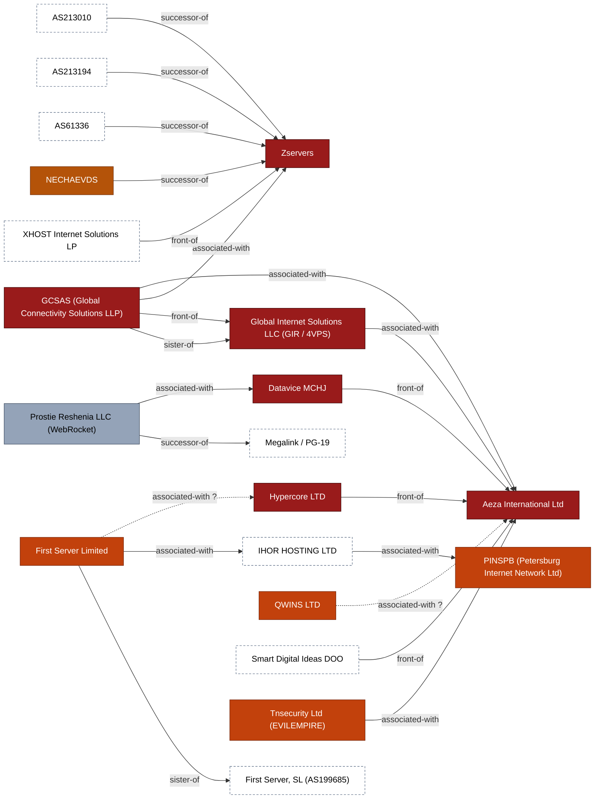

#### MIRhosting B.V., PQ Hosting Plus S.R.L., Stark Industries Solutions, WorkTitans B.V. / THE.Hosting and 1 more

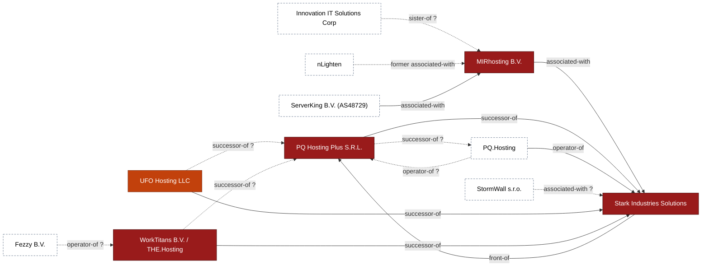

#### Railnet LLC / Virtualine Technologies, Karina Rashkovska, KPROHOST, metaspinner-named AS209800 (Virtualine front) and 1 more

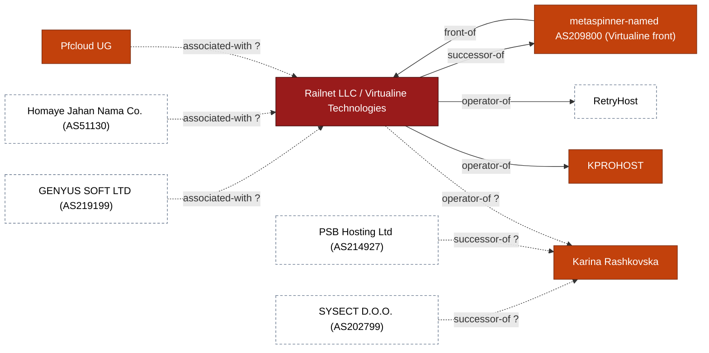

#### CTG Server Limited, FUNNULL Technology Inc.

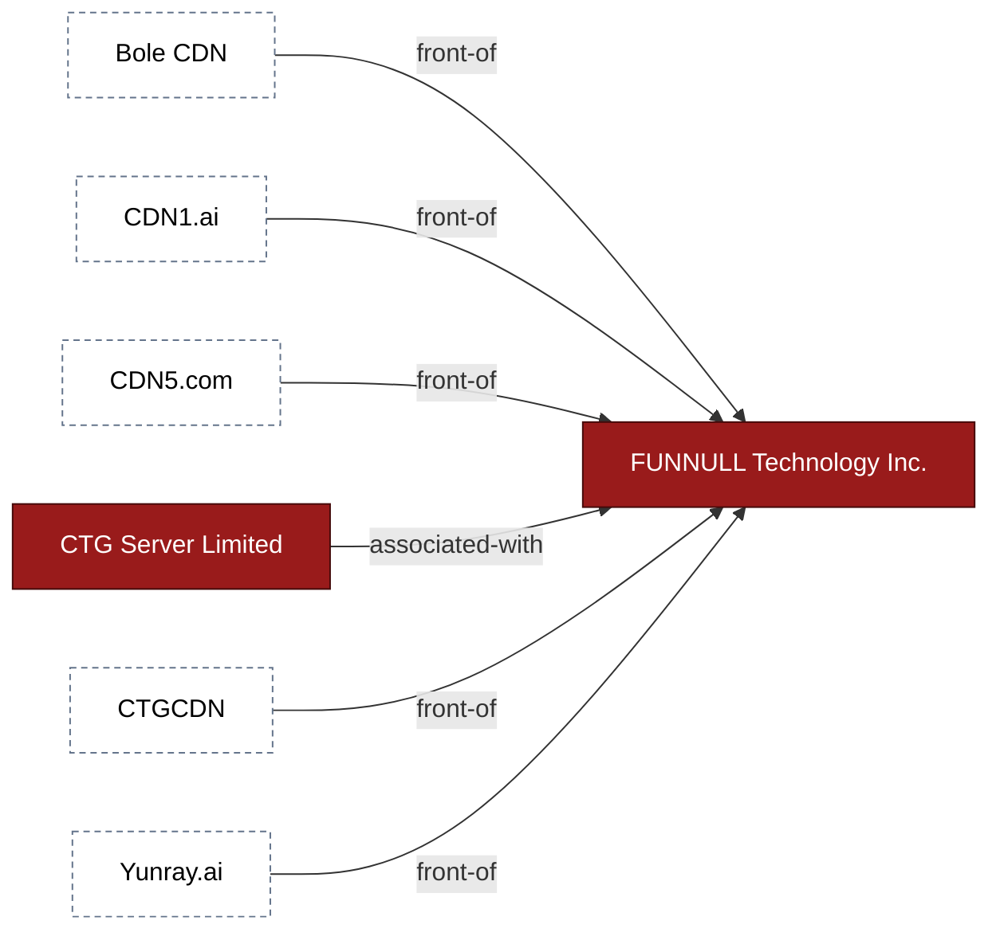

#### BL Networks (BitLaunch)

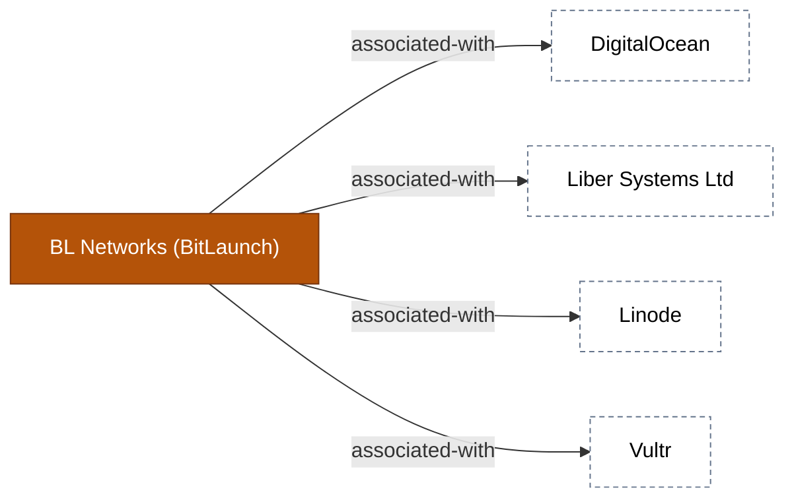

#### aurologic GmbH

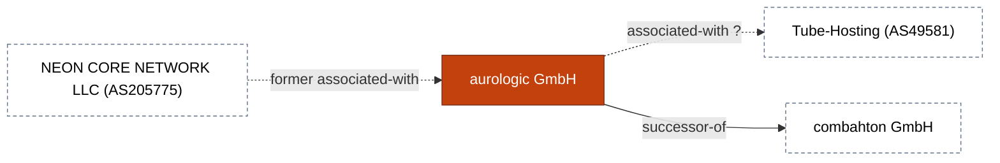

#### PrivateAlps / Private Layer, Global-Data System IT Corp (SWISSNETWORK02)

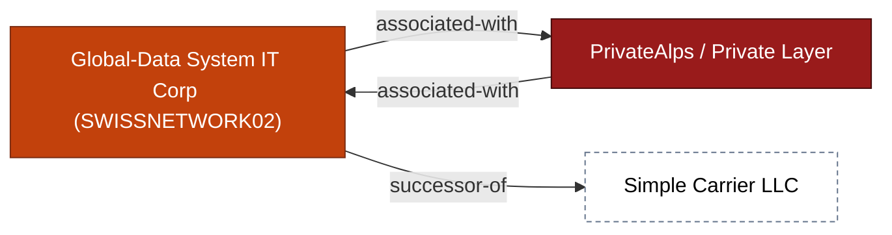

#### Media Land LLC

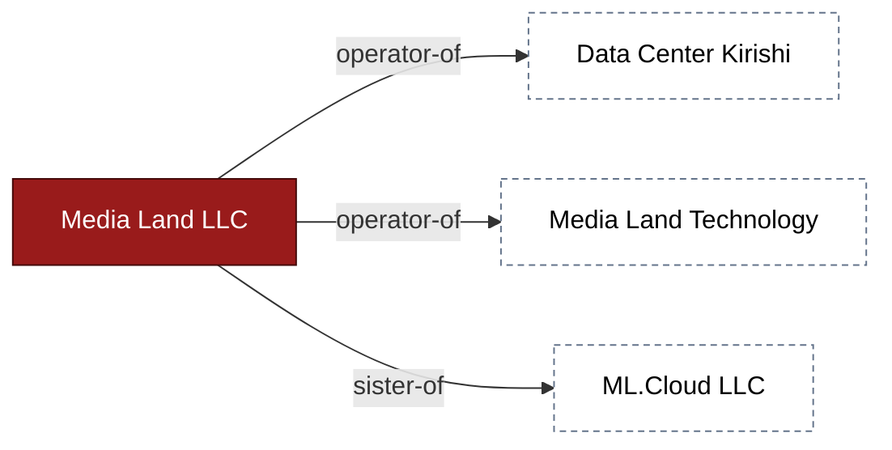

#### QTFY (QScan / QTRouter)

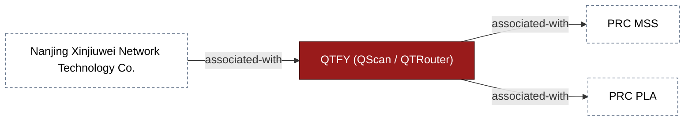

#### AnonRDP / Blatant Technologies, UAB Host Baltic (serveroffer.lt)

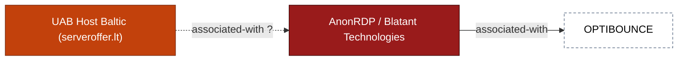

#### Kaopu Cloud HK Limited

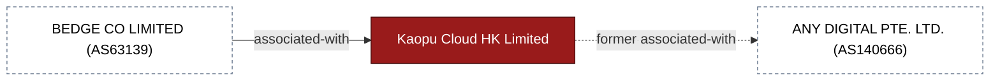

#### PROSPERO OOO / Proton66, Chang Way Technologies Co. Limited

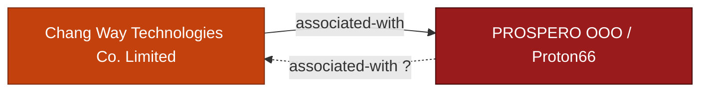

#### DDoS-Guard

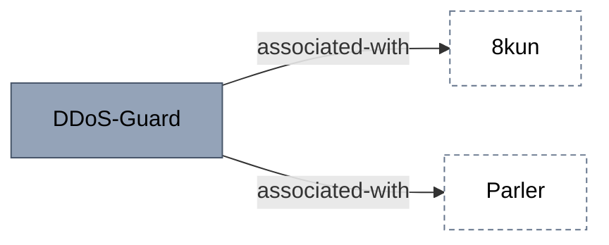

#### CrazyRDP

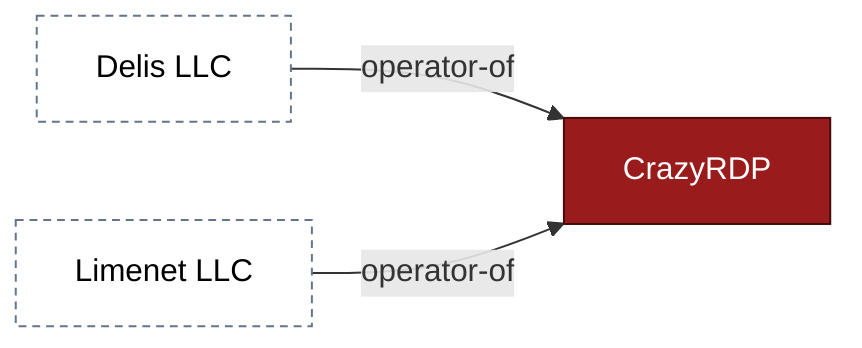

#### Phanes Networks

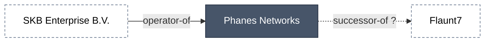

#### Tiger Network Limited (Tiger Net)

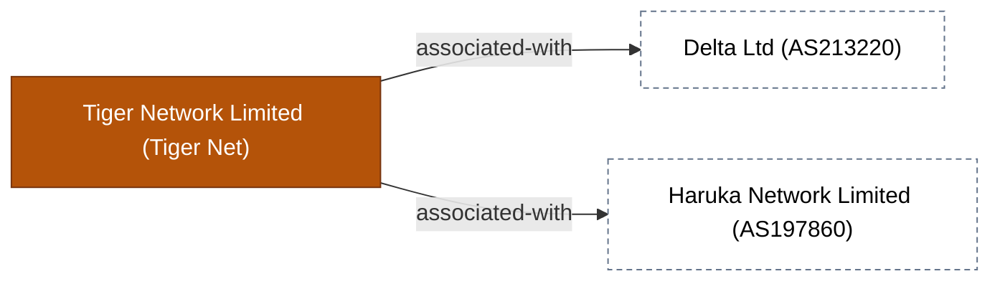

#### Other single links

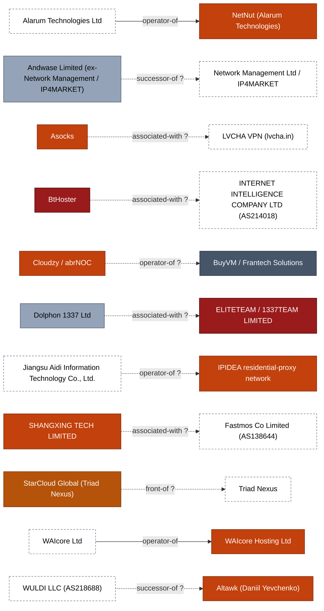

### Network supply

54 relationships: upstream transit and IP-space suppliers.

#### Aeza International Ltd, BtHoster, Femo IT Solutions Ltd (Defhost), Railnet LLC / Virtualine Technologies and 13 more

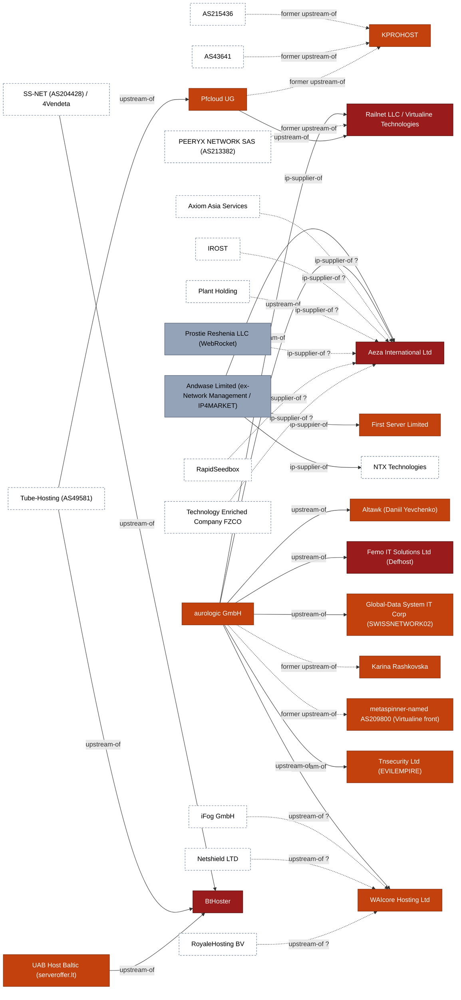

#### Kaopu Cloud HK Limited

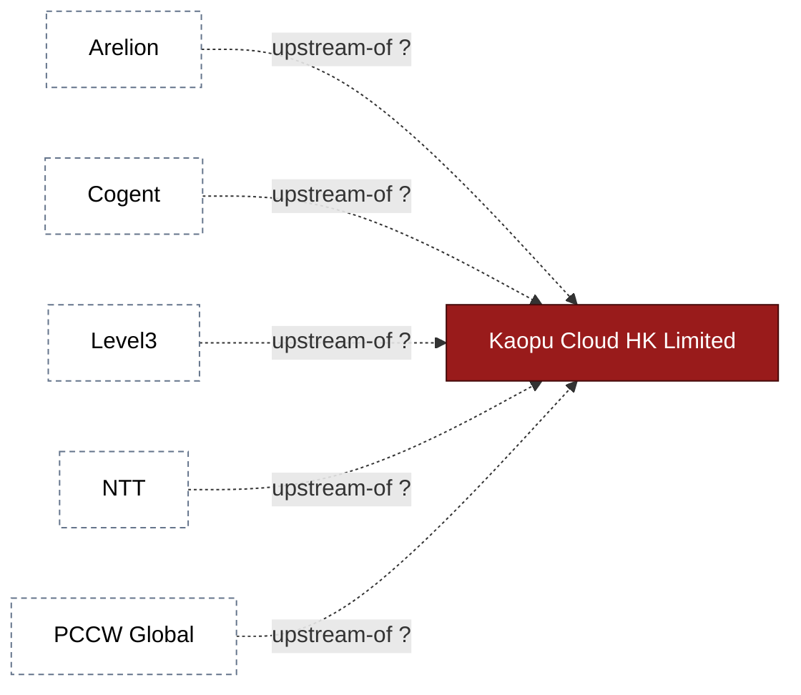

#### ELITETEAM / 1337TEAM LIMITED, DDoS-Guard

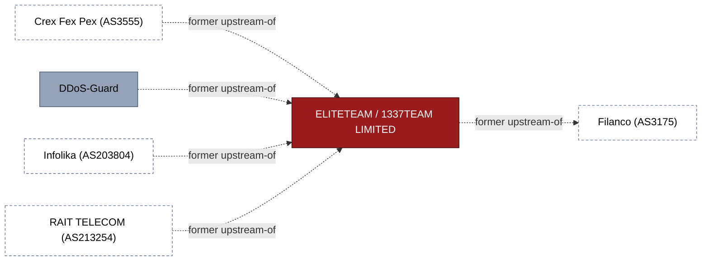

#### MIRhosting B.V., WorkTitans B.V. / THE.Hosting

```mermaid
flowchart LR
  n1["ADCDATA.COM (AS135330)"]:::ext
  n2["WorkTitans B.V. / THE.Hosting"]:::t1
  n1 -->|upstream-of| n2
  n3["FBW Networks (AS49434)"]:::ext
  n3 -->|upstream-of| n2
  n4["MIRhosting B.V."]:::t1
  n4 -.->|former upstream-of| n2
  n5["PIXOOF TEKNOLOJI (AS51722)"]:::ext
  n2 -->|ip-supplier-of| n5
  classDef t1 fill:#991b1b,color:#fff,stroke:#450a0a
  classDef ext fill:#fff,color:#000,stroke:#64748b,stroke-dasharray:4 3
```

#### HostSlick

```mermaid
flowchart LR
  n1["GTT"]:::ext
  n2["HostSlick"]:::t3
  n1 -.->|upstream-of ?| n2
  n3["TATA"]:::ext
  n3 -.->|upstream-of ?| n2
  n4["WorldStream (AS49981)"]:::ext
  n4 -.->|former upstream-of| n2
  classDef t3 fill:#b45309,color:#fff,stroke:#78350f
  classDef ext fill:#fff,color:#000,stroke:#64748b,stroke-dasharray:4 3
```

#### Chang Way Technologies Co. Limited

```mermaid
flowchart LR
  n1["Chang Way Technologies Co. Limited"]:::t2
  n2["B2 Net Solutions / ServerMania (AS55286)"]:::ext
  n1 -->|ip-supplier-of| n2
  n3["OVH"]:::ext
  n3 -->|upstream-of| n1
  classDef t2 fill:#c2410c,color:#fff,stroke:#7c2d12
  classDef ext fill:#fff,color:#000,stroke:#64748b,stroke-dasharray:4 3
```

#### Other single links

```mermaid
flowchart LR
  n1["NovoServe B.V. (AS204601)"]:::ext
  n2["Zomro B.V."]:::t5
  n1 -->|upstream-of| n2
  n3["Serverion / Des Capital B.V."]:::ext
  n4["CrazyRDP"]:::t1
  n3 -.->|upstream-of ?| n4
  n5["SMARTNET (AS203446)"]:::ext
  n6["AnonRDP / Blatant Technologies"]:::t1
  n5 -->|upstream-of| n6
  n7["SpectraIP (AS62068/AS218878)"]:::ext
  n8["Phanes Networks"]:::t4
  n7 -->|upstream-of| n8
  n9["Voxility"]:::ext
  n10["AlexHost"]:::t4
  n9 -.->|upstream-of ?| n10
  classDef t1 fill:#991b1b,color:#fff,stroke:#450a0a
  classDef t4 fill:#475569,color:#fff,stroke:#1e293b
  classDef t5 fill:#94a3b8,color:#000,stroke:#475569
  classDef ext fill:#fff,color:#000,stroke:#64748b,stroke-dasharray:4 3
```

### Financial layer

27 relationships: payment rails and the financial enablers.

#### A7A5 / Old Vector, Aeza International Ltd, Femo IT Solutions Ltd (Defhost), First VPN Service (1VPNS) and 11 more

```mermaid
flowchart LR
  n1["A7 Network"]:::ext
  n2["Nobitex"]:::t2
  n1 -->|associated-with| n2
  n3["A7A5 / Old Vector"]:::t1
  n1 -->|operator-of| n3
  n4["Grinex"]:::t1
  n3 -->|associated-with| n4
  n5["Aban Tether"]:::ext
  n6["Bitpin"]:::t3
  n5 -.->|associated-with ?| n6
  n5 -.->|associated-with ?| n2
  n7["Ramzinex"]:::t3
  n5 -.->|associated-with ?| n7
  n8["Wallex"]:::t3
  n5 -.->|associated-with ?| n8
  n9["Garantex"]:::t1
  n9 -->|associated-with| n3
  n10["Exved"]:::ext
  n9 -->|associated-with| n10
  n11["InDeFi Bank"]:::ext
  n9 -->|associated-with| n11
  n12["Aeza International Ltd"]:::t1
  n9 -->|payment-rail-of| n12
  n13["Media Land LLC"]:::t1
  n9 -->|payment-rail-of| n13
  n14["Zservers"]:::t1
  n9 -->|payment-rail-of| n14
  n4 -->|successor-of| n9
  n15["MKAN Coin"]:::ext
  n15 -->|associated-with| n9
  n16["TokenSpot CJSC"]:::t1
  n16 -->|front-of| n4
  n17["Xeltox Enterprises Ltd (Cryptomus / Heleket)"]:::t2
  n17 -->|payment-rail-of| n12
  n18["Femo IT Solutions Ltd (Defhost)"]:::t1
  n17 -.->|payment-rail-of ?| n18
  n19["First VPN Service (1VPNS)"]:::t1
  n17 -->|payment-rail-of| n19
  n20["Stark Industries Solutions"]:::t1
  n17 -->|payment-rail-of| n20
  n17 -->|payment-rail-of| n14
  n21["Yandex"]:::ext
  n21 -.->|associated-with ?| n3
  classDef t1 fill:#991b1b,color:#fff,stroke:#450a0a
  classDef t2 fill:#c2410c,color:#fff,stroke:#7c2d12
  classDef t3 fill:#b45309,color:#fff,stroke:#78350f
  classDef ext fill:#fff,color:#000,stroke:#64748b,stroke-dasharray:4 3
```

#### Dabai Guarantee, Tudou Guarantee

```mermaid
flowchart LR
  n1["Dabai Guarantee"]:::t2
  n2["Huione Guarantee (Haowang Guarantee)"]:::ext
  n1 -->|successor-of| n2
  n3["Tudou Guarantee"]:::t2
  n2 -->|associated-with| n3
  n3 -->|successor-of| n2
  classDef t2 fill:#c2410c,color:#fff,stroke:#7c2d12
  classDef ext fill:#fff,color:#000,stroke:#64748b,stroke-dasharray:4 3
```

#### H-Pay Service PLC

```mermaid
flowchart LR
  n1["H-Pay Service PLC"]:::t2
  n2["Huione Pay"]:::ext
  n1 -->|successor-of| n2
  n3["Huione Group"]:::ext
  n3 -->|operator-of| n1
  classDef t2 fill:#c2410c,color:#fff,stroke:#7c2d12
  classDef ext fill:#fff,color:#000,stroke:#64748b,stroke-dasharray:4 3
```
<!-- generated:appendix-c:end -->

---

*This ecosystem map is a living analytical product. Update as new corporate relationships are identified, sanctions are issued, or infrastructure migrations are observed. Cross-reference all provider assessments against the risk tier definitions in [`taxonomy/BPH_TAXONOMY.md`](../taxonomy/BPH_TAXONOMY.md).*
